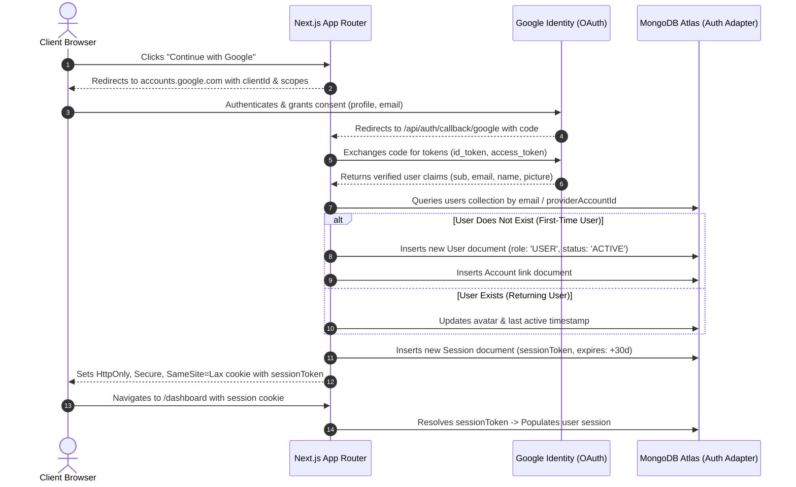

# Authentication & Authorization Architecture

## Document Information
- **Document Title**: Identity Management, Google OAuth, Auth.js & Role-Based Access Control (RBAC)
- **Phase**: W0 — Architecture & Product Specification
- **Version**: 1.0.0
- **Status**: Approved Baseline
- **Identity Framework**: Auth.js (NextAuth.js v5)
- **Session Strategy**: MongoDB-Backed Database Sessions (Strictly No Custom JWT Web Sessions)

---

## 1. Identity Architecture Overview

The marketplace relies on **Google Identity Services (OAuth 2.0 / OpenID Connect)** for single-click, passwordless authentication. 

### Fundamental Security Tenets
1. **Identity $\ne$ Authorization**: Google OAuth verifies *who* the user is (identity authentication). It provides zero authority regarding *what* the user is allowed to do within the marketplace (authorization). All application permissions (`USER` vs `ADMIN`, listing ownership, booking mutation rights) are stored in and evaluated from the application database.
2. **Server-Side Enforcement**: Hiding a button, hiding a link, or disabling a form in React client code is cosmetic UI feedback, **never** security. Every API Route Handler and Server-Side Service Function performs an explicit, non-bypassable ownership and role verification.
3. **MongoDB-Backed Database Sessions**: Web sessions are stored as stateful records in the MongoDB `sessions` collection. This allows immediate, unilateral session revocation (e.g., when a user is suspended by an admin or deletes their account), which is impossible with stateless client-side JWTs without complex blacklisting.



---

## 2. Auth.js Configuration & Adapter Setup

### 2.1 Configuration Specification (`src/lib/auth.ts`)
```typescript
import NextAuth from 'next-auth';
import Google from 'next-auth/providers/google';
import { MongoDBAdapter } from '@auth/mongodb-adapter';
import clientPromise from '@/lib/mongodb-client';
import { connectToDatabase } from '@/lib/db';
import { User } from '@/models/User';

export const { handlers, auth, signIn, signOut } = NextAuth({
  adapter: MongoDBAdapter(clientPromise, {
    collections: {
      Users: 'users',
      Accounts: 'accounts',
      Sessions: 'sessions',
      VerificationTokens: 'verificationTokens',
    },
  }),
  providers: [
    Google({
      clientId: process.env.AUTH_GOOGLE_ID!,
      clientSecret: process.env.AUTH_GOOGLE_SECRET!,
      allowDangerousEmailAccountLinking: false, // Prevent account takeover
    }),
  ],
  session: {
    strategy: 'database', // Enforce MongoDB database sessions
    maxAge: 30 * 24 * 60 * 60, // 30 Days rolling expiration
    updateAge: 24 * 60 * 60, // Refresh session expiry daily
  },
  cookies: {
    sessionToken: {
      name: process.env.NODE_ENV === 'production' 
        ? '__Secure-authjs.session-token' 
        : 'authjs.session-token',
      options: {
        httpOnly: true,
        sameSite: 'lax',
        path: '/',
        secure: process.env.NODE_ENV === 'production',
      },
    },
  },
  callbacks: {
    async session({ session, user }) {
      // Connect to Mongoose to ensure custom user profile fields are present
      await connectToDatabase();
      
      if (session.user) {
        session.user.id = user.id;
        // Inject application role and phone from DB model into session
        const dbUser = await User.findById(user.id).select('role status phone whatsapp');
        if (dbUser) {
          session.user.role = dbUser.role || 'USER';
          session.user.status = dbUser.status || 'ACTIVE';
          session.user.phone = dbUser.phone || null;
        }
      }
      return session;
    },
  },
  pages: {
    signIn: '/auth/signin',
    error: '/auth/signin',
  },
});
```

---

## 3. First-Time vs Returning User Lifecycle

### 3.1 First-Time User Registration
1. User completes Google consent.
2. Auth.js adapter looks up `users` collection by `email`.
3. Finding no existing user, it inserts a new document:
   - `role`: Defaulted to `'USER'`. Under no circumstances can a user register as an `'ADMIN'` through OAuth.
   - `status`: Defaulted to `'ACTIVE'`.
   - `name`, `email`, `image`: Extracted directly from verified Google profile.
   - `contactPreferences`: Defaulted to `{ showPhone: true, showWhatsapp: true }`.
4. User is redirected to `/dashboard` with an active session. A non-intrusive banner suggests: *"Complete your profile with a phone number to post listings or book services."*

### 3.2 Returning User Login
1. User logs in with Google.
2. Auth.js verifies Google signature and finds matching `providerAccountId` in `accounts` and matching `users` record.
3. System checks `user.status`:
   - If `status === 'SUSPENDED'`: Authentication is aborted immediately, throwing `AccessDenied`.
   - If `status === 'ACTIVE'`: A new database session is created in `sessions`.
4. User is redirected back to their intended destination (`callbackUrl`).

---

## 4. Role-Based Access Control (RBAC) Matrix

The marketplace enforces two distinct user roles in the database:
- `USER`: Regular public account (can browse, create property listings, create service listings, request bookings, and manage received bookings).
- `ADMIN`: Platform staff and moderation personnel.

| Resource / Action | Unauthenticated Visitor | Authenticated `USER` (Any) | Resource Owner | `ADMIN` |
| :--- | :---: | :---: | :---: | :---: |
| **Browse / Search Approved Listings** | Allowed | Allowed | Allowed | Allowed |
| **View Listing Details & Photos** | Allowed | Allowed | Allowed | Allowed |
| **Reveal Contact Info (Rate-Limited)** | Allowed | Allowed | Allowed | Allowed |
| **Create Property / Service Listing** | Denied (401) | Allowed (`PENDING_REVIEW`) | Allowed | Allowed |
| **View Own Listings (Any Status)** | Denied (401) | Denied (403) | Allowed | Allowed |
| **Edit / Pause / Archive Listing** | Denied (401) | Denied (403) | Allowed | Allowed |
| **Approve / Reject Listing in Queue** | Denied (401) | Denied (403) | Denied (403) | Allowed |
| **Save / Unsave Favorite** | Denied (401) | Allowed | Allowed | Allowed |
| **Submit Service Booking Request** | Denied (401) | Allowed | Denied (Own Listing) | Allowed |
| **Accept / Decline Booking Request** | Denied (401) | Denied (403) | Provider Only | Allowed |
| **Cancel Booking Request** | Denied (401) | Denied (403) | Customer/Provider | Allowed |
| **Submit Listing Complaint Report** | Allowed | Allowed | Allowed | Allowed |
| **Inspect Reports & Audit Logs** | Denied (401) | Denied (403) | Denied (403) | Allowed |
| **Suspend / Ban User Account** | Denied (401) | Denied (403) | Denied (403) | Allowed |

---

## 5. Server-Side Authorization Enforcement Pattern

Every server-side Route Handler and Service mutation MUST enforce explicit authorization checks before mutating state.

### 5.1 Reusable Guard Functions (`src/lib/auth-guards.ts`)
```typescript
import { auth } from '@/lib/auth';
import { ForbiddenError, UnauthorizedError } from '@/lib/errors';
import mongoose from 'mongoose';

export interface AuthenticatedSession {
  user: {
    id: string;
    email: string;
    name: string;
    role: 'USER' | 'ADMIN';
    status: 'ACTIVE' | 'SUSPENDED';
    phone?: string | null;
  };
}

/**
 * Ensures a request has a valid active database session.
 */
export async function requireAuth(): Promise<AuthenticatedSession> {
  const session = await auth();
  if (!session || !session.user || !session.user.id) {
    throw new UnauthorizedError('Authentication is required to perform this action.');
  }

  if (session.user.status === 'SUSPENDED') {
    throw new ForbiddenError('Your account has been suspended. Please contact support.');
  }

  return session as AuthenticatedSession;
}

/**
 * Ensures the user has ADMIN privileges.
 */
export async function requireAdmin(): Promise<AuthenticatedSession> {
  const session = await requireAuth();
  if (session.user.role !== 'ADMIN') {
    throw new ForbiddenError('Administrative privileges are required.');
  }
  return session;
}

/**
 * Verifies that the authenticated user owns the target resource or is an admin.
 */
export function assertOwnership(
  resourceOwnerId: mongoose.Types.ObjectId | string,
  session: AuthenticatedSession
): void {
  const ownerIdStr = resourceOwnerId.toString();
  const userIdStr = session.user.id.toString();

  if (session.user.role !== 'ADMIN' && ownerIdStr !== userIdStr) {
    throw new ForbiddenError('You do not have permission to modify this resource.');
  }
}
```

### 5.2 Application Example: Listing Mutation Guard
```typescript
// Example inside src/app/api/v1/listings/[id]/route.ts
export async function PATCH(req: Request, { params }: { params: { id: string } }) {
  const session = await requireAuth();
  const listing = await Listing.findById(params.id);

  if (!listing) {
    return NextResponse.json({ success: false, error: { code: 'NOT_FOUND', message: 'Listing not found' } }, { status: 404 });
  }

  // Enforce zero-trust ownership
  assertOwnership(listing.ownerId, session);

  // Execute mutation...
}
```

---

## 6. Route Protection Architecture (Middleware & RSC)

### 6.1 Edge Middleware (`src/middleware.ts`)
Performs coarse-grained URL perimeter defense before requests reach Node.js execution:
- Checks for the presence of the session cookie for routes matching `/dashboard/*` and `/admin/*`.
- Unauthenticated requests to `/dashboard/*` are immediately redirected to `/auth/signin?callbackUrl=...`.
- Non-admin requests attempting to access `/admin/*` are bounced to `/` with an access denied flag.

### 6.2 Defense-in-Depth in Page Layouts (Server Components)
Middleware can be bypassed in edge misconfigurations; therefore, page layouts enforce secondary checks:
```typescript
// src/app/admin/layout.tsx
import { auth } from '@/lib/auth';
import { redirect } from 'next/navigation';

export default async function AdminLayout({ children }: { children: React.ReactNode }) {
  const session = await auth();

  if (!session?.user) {
    redirect('/auth/signin?callbackUrl=/admin');
  }

  if (session.user.role !== 'ADMIN') {
    redirect('/?error=Forbidden');
  }

  return <div className="admin-shell">{children}</div>;
}
```

---

## 7. Account Linking & Security Safeguards

1. **Safe Account Linking Disabled**:
   - `allowDangerousEmailAccountLinking` is set to `false` in Auth.js.
   - This prevents identity-spoofing vectors where an attacker registers an OAuth account on a secondary provider with a victim's email to gain access to their existing account.
2. **Session Invalidation on Suspension**:
   - When an administrator changes a user's status to `SUSPENDED`, a database hook immediately deletes all rows in `sessions` where `userId === targetUserId`.
   - The user's subsequent HTTP requests instantly fail with `401 Unauthenticated`.
3. **OAuth Secret Hygiene**:
   - `AUTH_SECRET`, `AUTH_GOOGLE_ID`, and `AUTH_GOOGLE_SECRET` are never exposed to client bundles (no `NEXT_PUBLIC_` prefix).
   - Local development uses `.env.local` (strictly excluded via `.gitignore`).
