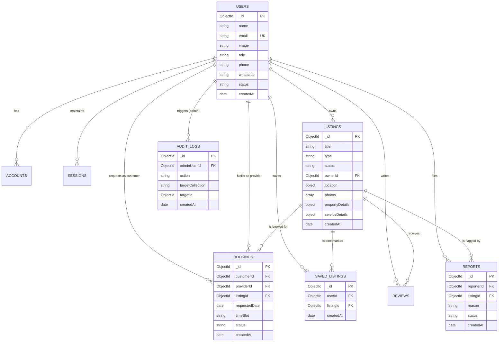
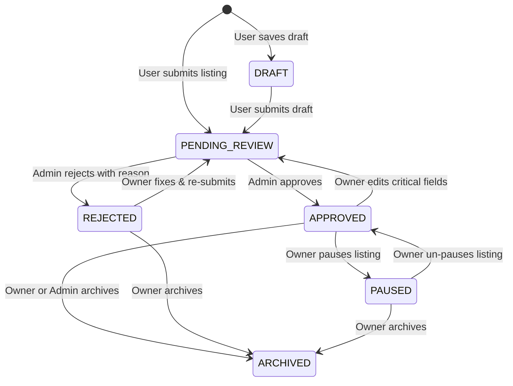
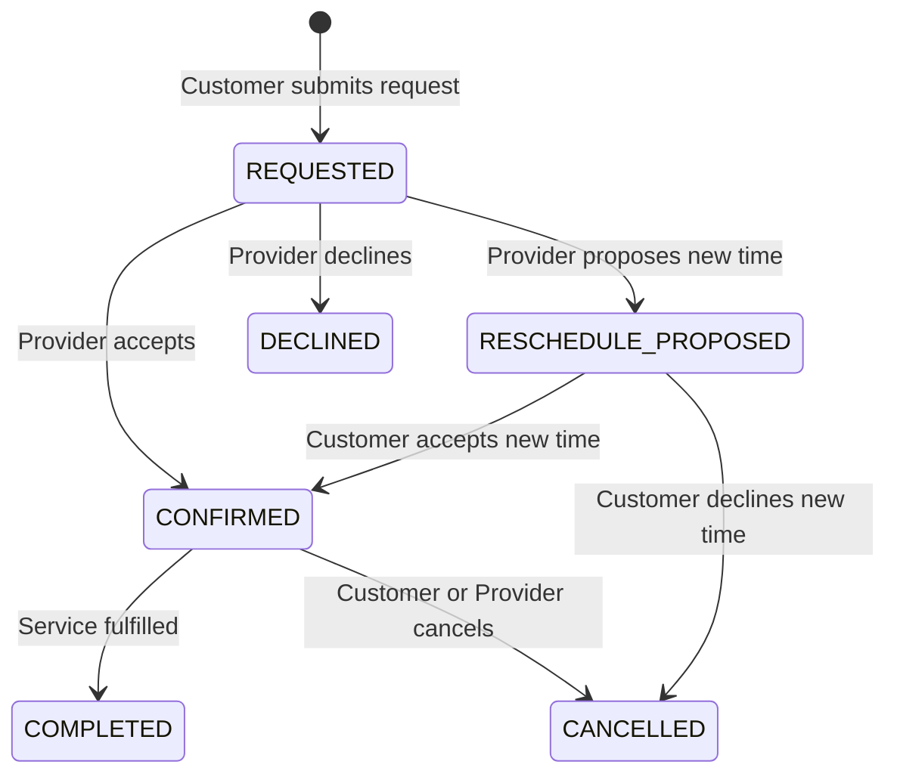

# Database Schema & Data Models Specification

## Document Information
- **Document Title**: MongoDB Data Architecture, Collection Schemas & Indexing Strategy
- **Phase**: W0 — Architecture & Product Specification
- **Version**: 1.0.0
- **Status**: Approved Baseline
- **Database Engine**: MongoDB Atlas 7.0+ (Mongoose 8.x ODM)

---

## 1. Data Modeling Strategy & Schema Topology

The database architecture is designed with MongoDB best practices:
1. **Hybrid Listing Polymorphism**: The `listings` collection uses a single-collection polymorphic schema with a discriminant field (`type: 'PROPERTY' | 'SERVICE'`). Common fields (title, slug, status, owner, location, photos, contact preferences, stats) share a uniform root schema, while vertical-specific attributes are encapsulated in typed subdocuments (`propertyDetails` and `serviceDetails`).
2. **Auth.js Compatibility**: Schema for user authentication strictly conforms to the official `@auth/mongodb-adapter` contract while seamlessly enriching the `users` collection with marketplace-specific profile fields.
3. **No Binary Blobs**: Media assets are referenced strictly by cloud-storage URLs and keys.
4. **Geospatial & Compound Indexing**: All geographic coordinates are stored in GeoJSON Point format (`[longitude, latitude]`) with `2dsphere` indexes to power hyper-local discovery.

---

## 2. Detailed Collection Schemas

### 2.1 `users` Collection (Auth.js + Marketplace Profile)
Stores user credentials, Google profile information, contact preferences, and marketplace roles.

| Field Name | BSON Type | Required | Default | Validation / Constraints | Description |
| :--- | :--- | :--- | :--- | :--- | :--- |
| `_id` | `ObjectId` | Yes | Auto | Unique MongoDB Identifier | User identifier. |
| `name` | `String` | Yes | - | Max 100 chars, trimmed | Full display name (synced from Google OAuth). |
| `email` | `String` | Yes | - | Valid email, lowercase, unique | User's primary email address. |
| `emailVerified` | `Date` | No | `null` | ISO Date | Timestamp verified by OAuth provider. |
| `image` | `String` | No | `null` | Valid URL | Google profile avatar URL. |
| `role` | `String` | Yes | `'USER'` | Enum: `['USER', 'ADMIN']` | Role-based authorization tier. |
| `phone` | `String` | No | `null` | E.164 phone format or 10-digit standard | Contact phone number for enquiries. |
| `whatsapp` | `String` | No | `null` | E.164 format or 10-digit standard | WhatsApp direct contact number. |
| `status` | `String` | Yes | `'ACTIVE'` | Enum: `['ACTIVE', 'SUSPENDED', 'DELETED']` | Account standing and access control. |
| `contactPreferences`| `Object` | Yes | `{}` | Embedded subdocument | Default contact visibility flags. |
| `contactPreferences.showPhone` | `Boolean` | Yes | `true` | Boolean | Expose phone on listings by default. |
| `contactPreferences.showWhatsapp` | `Boolean` | Yes | `true` | Boolean | Expose WhatsApp button on listings. |
| `deletedAt` | `Date` | No | `null` | ISO Date | Soft delete timestamp. |
| `createdAt` | `Date` | Yes | Auto | ISO Date | Account creation timestamp. |
| `updatedAt` | `Date` | Yes | Auto | ISO Date | Last update timestamp. |

**Indexes**:
- `{ email: 1 }` (Unique)
- `{ role: 1, status: 1 }`

---

### 2.2 `accounts` Collection (Auth.js Adapter)
Manages OAuth provider links for users (conforms to NextAuth / Auth.js standard).

| Field Name | BSON Type | Required | Description |
| :--- | :--- | :--- | :--- |
| `_id` | `ObjectId` | Yes | Primary Key. |
| `userId` | `ObjectId` | Yes | Ref: `users._id` (Owner of this account link). |
| `type` | `String` | Yes | Provider type (e.g., `'oauth'`). |
| `provider` | `String` | Yes | OAuth provider identifier (`'google'`). |
| `providerAccountId`| `String` | Yes | Unique ID provided by Google (Google sub). |
| `refresh_token` | `String` | No | Encrypted OAuth refresh token. |
| `access_token` | `String` | No | Short-lived OAuth access token. |
| `expires_at` | `Number` | No | Unix epoch timestamp of token expiry. |
| `token_type` | `String` | No | E.g., `'Bearer'`. |
| `scope` | `String` | No | Granted OAuth scopes. |
| `id_token` | `String` | No | Google OpenID Connect ID token. |

**Indexes**:
- `{ provider: 1, providerAccountId: 1 }` (Unique compound index)
- `{ userId: 1 }`

---

### 2.3 `sessions` Collection (Auth.js Database Sessions)
Maintains server-side session tokens for authenticated client sessions.

| Field Name | BSON Type | Required | Description |
| :--- | :--- | :--- | :--- |
| `_id` | `ObjectId` | Yes | Session ID. |
| `sessionToken` | `String` | Yes | Secure random session token stored in client HTTP-only cookie. (Unique) |
| `userId` | `ObjectId` | Yes | Ref: `users._id`. |
| `expires` | `Date` | Yes | Expiration timestamp (e.g., 30 days from issuance). |

**Indexes**:
- `{ sessionToken: 1 }` (Unique)
- `{ userId: 1 }`
- `{ expires: 1 }` (TTL index: automatically cleans up expired sessions)

---

### 2.4 `verificationTokens` Collection (Auth.js Adapter)
Stores temporary tokens for verification workflows.

| Field Name | BSON Type | Required | Description |
| :--- | :--- | :--- | :--- |
| `_id` | `ObjectId` | Yes | Token ID. |
| `identifier` | `String` | Yes | Email address or user identifier. |
| `token` | `String` | Yes | Cryptographic token string. |
| `expires` | `Date` | Yes | Expiration timestamp. |

**Indexes**:
- `{ identifier: 1, token: 1 }` (Unique compound index)
- `{ expires: 1 }` (TTL index)

---

### 2.5 `listings` Collection (Polymorphic: Property & Service)
The core marketplace collection housing both Property and Service offerings.

#### 2.5.1 Common Root Attributes (All Listings)

| Field Name | BSON Type | Required | Default | Description |
| :--- | :--- | :--- | :--- | :--- |
| `_id` | `ObjectId` | Yes | Auto | Unique listing identifier. |
| `type` | `String` | Yes | - | Discriminant: `['PROPERTY', 'SERVICE']`. |
| `status` | `String` | Yes | `'PENDING_REVIEW'` | Enum: `['DRAFT', 'PENDING_REVIEW', 'APPROVED', 'REJECTED', 'PAUSED', 'ARCHIVED']`. |
| `title` | `String` | Yes | - | Clean descriptive title (10 to 120 chars). |
| `slug` | `String` | Yes | - | URL-friendly unique slug (e.g., `spacious-2bhk-greenwood-a8f9`). |
| `description` | `String` | Yes | - | Markdown or plaintext description (30 to 4000 chars). |
| `ownerId` | `ObjectId` | Yes | - | Ref: `users._id` (Owner / Creator of listing). |
| `location` | `Object` | Yes | - | Geographic and postal location details. |
| `location.city` | `String` | Yes | - | City name (e.g., `'Metropolis'`). |
| `location.cityCode` | `String` | Yes | - | Normalized uppercase code (e.g., `'METRO'`). |
| `location.locality` | `String` | Yes | - | Locality / Neighborhood (e.g., `'Greenwood Valley'`). |
| `location.streetAddress`| `String` | No | `null` | Street address (kept private until direct contact/booking). |
| `location.geo` | `Object` | Yes | - | GeoJSON Point: `{ type: 'Point', coordinates: [lng, lat] }`. |
| `contactPreferences` | `Object` | Yes | - | Contact controls for this specific listing. |
| `contactPreferences.phone` | `String` | No | `null` | Specific contact phone (defaults to user.phone). |
| `contactPreferences.whatsapp` | `String` | No | `null` | Specific WhatsApp number (defaults to user.whatsapp). |
| `contactPreferences.showPhone` | `Boolean` | Yes | `true` | Whether to display the "Call" CTA. |
| `contactPreferences.showWhatsapp`| `Boolean` | Yes | `true` | Whether to display the "WhatsApp" CTA. |
| `photos` | `Array<Object>` | Yes | `[]` | Array of cloud storage media references (max 12). |
| `photos[].id` | `String` | Yes | - | Unique UUID for the photo. |
| `photos[].url` | `String` | Yes | - | Public CDN URL. |
| `photos[].key` | `String` | Yes | - | Storage bucket S3 key for management/deletion. |
| `photos[].isPrimary` | `Boolean` | Yes | `false` | Indicates the primary thumbnail image. |
| `photos[].caption` | `String` | No | `null` | Optional descriptive label. |
| `moderation` | `Object` | Yes | `{}` | Admin review audit subdocument. |
| `moderation.reviewedBy` | `ObjectId` | No | `null` | Ref: `users._id` (Admin who reviewed). |
| `moderation.reviewedAt` | `Date` | No | `null` | Timestamp of moderation action. |
| `moderation.rejectionReason`| `String` | No | `null` | Mandatory reason provided when rejected. |
| `metrics` | `Object` | Yes | `{ views: 0, contactReveals: 0, savesCount: 0 }` | Performance statistics. |
| `createdAt` | `Date` | Yes | Auto | Timestamp created. |
| `updatedAt` | `Date` | Yes | Auto | Timestamp updated. |

#### 2.5.2 Subdocument: `propertyDetails` (Present only if `type === 'PROPERTY'`)

| Field Name | BSON Type | Required | Constraints / Enums | Description |
| :--- | :--- | :--- | :--- | :--- |
| `purpose` | `String` | Yes | `['FOR_RENT', 'FOR_SALE', 'PG_CO_LIVING']` | Transaction model. |
| `propertyType` | `String` | Yes | `['APARTMENT', 'INDEPENDENT_HOUSE', 'VILLA', 'PLOT', 'COMMERCIAL']` | Architectural property classification. |
| `price` | `Number` | Yes | Min: 1, Max: 1,000,000,000 | Monthly rent or total sale price. |
| `securityDeposit` | `Number` | No | Min: 0 | Refundable security deposit. |
| `maintenanceFee` | `Number` | No | Min: 0 | Monthly maintenance charges. |
| `bedrooms` | `Number` | Conditional | Min: 0 (0 for Plot/Commercial), Max: 20 | Number of bedrooms (`BHK`). |
| `bathrooms` | `Number` | Conditional | Min: 0, Max: 20 | Number of bathrooms. |
| `balconies` | `Number` | No | Min: 0, Max: 10 | Number of balconies. |
| `carpetArea` | `Number` | Yes | Min: 10 (sqft) | Usable floor area in square feet. |
| `superArea` | `Number` | No | Min: 10 (sqft) | Total built-up area in square feet. |
| `furnishing` | `String` | Yes | `['UNFURNISHED', 'SEMI_FURNISHED', 'FULLY_FURNISHED']` | Interior furnishing condition. |
| `floorNumber` | `Number` | No | Min: -2 (Basement), Max: 150 | Unit floor level. |
| `totalFloors` | `Number` | No | Min: 1, Max: 150 | Total floors in building. |
| `amenities` | `Array<String>` | Yes | Array of approved amenity enums | `['LIFT', 'POWER_BACKUP', 'PARKING', 'SECURITY', 'WATER_SUPPLY', 'GYM', 'CLUBHOUSE', 'SWIMMING_POOL', 'GAS_PIPELINE']`. |
| `availableFrom` | `Date` | Yes | ISO Date | Date property is ready for occupancy. |
| `preferredTenants`| `String` | No | `['ANY', 'FAMILY', 'BACHELORS_MEN', 'BACHELORS_WOMEN', 'COMPANY_LEASE']` | Tenant preference filter. |

#### 2.5.3 Subdocument: `serviceDetails` (Present only if `type === 'SERVICE'`)

| Field Name | BSON Type | Required | Constraints / Enums | Description |
| :--- | :--- | :--- | :--- | :--- |
| `category` | `String` | Yes | `['PLUMBING', 'ELECTRICAL', 'CARPENTRY', 'CLEANING', 'PAINTING', 'APPLIANCE_REPAIR', 'PEST_CONTROL', 'MOVERS_PACKERS', 'OTHER']` | Primary service classification. |
| `pricingModel` | `String` | Yes | `['FIXED', 'HOURLY', 'QUOTE_BASED']` | Billing methodology. |
| `startingPrice` | `Number` | Conditional | Required if model is `FIXED` or `HOURLY` | Minimum price / baseline rate. |
| `experienceYears`| `Number` | Yes | Min: 0, Max: 60 | Professional experience of provider. |
| `serviceAreas` | `Array<String>` | Yes | Min 1 locality string | List of neighborhoods covered. |
| `workingDays` | `Array<String>` | Yes | Array of days: `['MON', 'TUE', 'WED', 'THU', 'FRI', 'SAT', 'SUN']` | Service operating days. |
| `workingHours` | `Object` | Yes | `{ start: '08:00', end: '20:00' }` | Daily working hours window. |
| `guarantees` | `String` | No | Max 500 chars | Warranty / guarantee notes (e.g. 30-day rework). |

**Indexes on `listings`**:
- `{ slug: 1 }` (Unique)
- `{ type: 1, status: 1, 'location.cityCode': 1, createdAt: -1 }` (Core search index)
- `{ 'location.geo': '2dsphere' }` (Geospatial proximity queries)
- `{ status: 1, 'propertyDetails.purpose': 1, 'propertyDetails.price': 1 }` (Property price filtering)
- `{ status: 1, 'propertyDetails.bedrooms': 1 }` (BHK filtering)
- `{ status: 1, 'serviceDetails.category': 1, 'serviceDetails.startingPrice': 1 }` (Service category search)
- `{ ownerId: 1, status: 1 }` (Owner's dashboard query)
- `{ title: 'text', description: 'text', 'location.locality': 'text' }` (Full-text search index)

---

### 2.6 `bookings` Collection
Tracks appointment requests initiated by customers for service listings.

| Field Name | BSON Type | Required | Default | Validation / Constraints | Description |
| :--- | :--- | :--- | :--- | :--- | :--- |
| `_id` | `ObjectId` | Yes | Auto | Unique ID | Booking identifier. |
| `customerId` | `ObjectId` | Yes | - | Ref: `users._id` | Customer requesting the booking. |
| `providerId` | `ObjectId` | Yes | - | Ref: `users._id` | Professional providing the service. |
| `listingId` | `ObjectId` | Yes | - | Ref: `listings._id` | The booked service listing. |
| `status` | `String` | Yes | `'PENDING'` | Enum: `['PENDING', 'ACCEPTED', 'REJECTED', 'ALTERNATIVE_PROPOSED', 'CANCELLED', 'COMPLETED']` (Aliases: `REQUESTED`, `CONFIRMED`, `DECLINED`, `RESCHEDULE_PROPOSED`) | State of booking lifecycle. |
| `requestedDate` | `Date` | Yes | - | Must be future date within 60 days | Date service is requested. |
| `timeSlot` | `String` | Yes | - | Enum: `['MORNING', 'AFTERNOON', 'EVENING']` or specific time string | Preferred time window. |
| `alternativeDetails`| `Object`| No | `null` | Subdocument | Populated if provider proposes alternative time. |
| `alternativeDetails.proposedDate` | `Date` | No | - | Proposed new date. |
| `alternativeDetails.proposedSlot` | `String` | No | - | Proposed new time slot. |
| `alternativeDetails.note` | `String` | No | - | Provider explanation. |
| `alternativeDetails.proposedAt` | `Date` | No | Auto | Timestamp when proposal was submitted. |
| `serviceAddress` | `Object` | Yes | - | Address where service is to be rendered. |
| `serviceAddress.line1` | `String` | Yes | - | House/Flat number, Street name. |
| `serviceAddress.locality`| `String` | Yes | - | Locality / Area. |
| `serviceAddress.city` | `String` | No | `null` | City name. |
| `customerNotes` | `String` | No | `null` | Max 1000 chars | Description of the problem or task scope. |
| `customerPhone` | `String` | Yes | - | Contact phone for technician visit. |
| `providerNotes` | `String` | No | `null` | Max 1000 chars | Provider's internal notes or decline reason. |
| `statusHistory` | `Array<Object>`| Yes | `[]` | Audit log of state transitions | `[{ status: string, changedBy: ObjectId, timestamp: Date, note: string }]`. |
| `createdAt` | `Date` | Yes | Auto | ISO Date | Timestamp created. |
| `updatedAt` | `Date` | Yes | Auto | ISO Date | Timestamp updated. |

**Indexes**:
- `{ customerId: 1, status: 1, requestedDate: -1 }` (Customer booking list)
- `{ providerId: 1, status: 1, requestedDate: -1 }` (Provider booking queue)
- `{ listingId: 1, status: 1 }`
- `{ createdAt: -1 }`

---

### 2.7 `savedListings` Collection
Tracks bookmarking of properties and services by users.

| Field Name | BSON Type | Required | Description |
| :--- | :--- | :--- | :--- |
| `_id` | `ObjectId` | Yes | Primary Key. |
| `userId` | `ObjectId` | Yes | Ref: `users._id` (The bookmarking user). |
| `listingId` | `ObjectId` | Yes | Ref: `listings._id` (The bookmarked listing). |
| `createdAt` | `Date` | Yes | Timestamp of saving. |

**Indexes**:
- `{ userId: 1, listingId: 1 }` (Unique compound constraint: prevents duplicate saves)
- `{ userId: 1, createdAt: -1 }`

---

### 2.8 `reviews` Collection
Stores customer feedback and ratings for completed service bookings or verified interactions.

| Field Name | BSON Type | Required | Default | Validation / Constraints | Description |
| :--- | :--- | :--- | :--- | :--- | :--- |
| `_id` | `ObjectId` | Yes | Auto | Primary Key | Review identifier. |
| `listingId` | `ObjectId` | Yes | - | Ref: `listings._id` | Reviewed listing. |
| `authorId` | `ObjectId` | Yes | - | Ref: `users._id` | Author of the review. |
| `rating` | `Number` | Yes | - | Min: 1, Max: 5 (Integer) | Star rating. |
| `comment` | `String` | Yes | - | Min: 5, Max: 1000 chars | Written evaluation. |
| `status` | `String` | Yes | `'PUBLISHED'` | Enum: `['PUBLISHED', 'HIDDEN', 'FLAGGED']` | Moderation state. |
| `createdAt` | `Date` | Yes | Auto | ISO Date | Timestamp created. |

**Indexes**:
- `{ listingId: 1, status: 1, createdAt: -1 }`
- `{ authorId: 1, listingId: 1 }` (Unique: one review per user per listing)

---

### 2.9 `reports` Collection
Tracks user-submitted complaints and fraud alerts against listings.

| Field Name | BSON Type | Required | Default | Validation / Constraints | Description |
| :--- | :--- | :--- | :--- | :--- | :--- |
| `_id` | `ObjectId` | Yes | Auto | Primary Key | Report identifier. |
| `listingId` | `ObjectId` | Yes | - | Ref: `listings._id` | Offending listing. |
| `reporterId` | `ObjectId` | No | `null` | Ref: `users._id` (null if guest) | User filing complaint. |
| `reporterEmail` | `String` | Yes | - | Valid email | Email for communication. |
| `reason` | `String` | Yes | - | Enum: `['SPAM', 'FAKE_PROPERTY', 'INACCURATE_PRICE', 'OFFENSIVE_CONTENT', 'OTHER']` | Category of violation. |
| `details` | `String` | Yes | - | Min: 10, Max: 2000 chars | Detailed explanation of issue. |
| `status` | `String` | Yes | `'OPEN'` | Enum: `['OPEN', 'INVESTIGATING', 'RESOLVED', 'DISMISSED']` | Moderation workflow status. |
| `adminNotes` | `String` | No | `null` | Internal moderator notes | Resolution commentary. |
| `resolvedBy` | `ObjectId` | No | `null` | Ref: `users._id` | Admin who closed report. |
| `resolvedAt` | `Date` | No | `null` | ISO Date | Timestamp of resolution. |
| `createdAt` | `Date` | Yes | Auto | ISO Date | Creation timestamp. |

**Indexes**:
- `{ status: 1, createdAt: -1 }`
- `{ listingId: 1 }`

---

### 2.10 `notifications` Collection
Stores in-app status notifications for users (e.g., listing approved, booking confirmed).

| Field Name | BSON Type | Required | Default | Description |
| :--- | :--- | :--- | :--- | :--- |
| `_id` | `ObjectId` | Yes | Auto | Notification ID. |
| `recipientId` | `ObjectId` | Yes | - | Ref: `users._id`. |
| `type` | `String` | Yes | - | Enum: `['LISTING_APPROVED', 'LISTING_REJECTED', 'BOOKING_REQUESTED', 'BOOKING_CONFIRMED', 'BOOKING_CANCELLED']`. |
| `title` | `String` | Yes | - | Short notification title. |
| `message` | `String` | Yes | - | Descriptive body text. |
| `linkUrl` | `String` | No | `null` | Destination link when clicked. |
| `isRead` | `Boolean` | Yes | `false` | Read receipt flag. |
| `createdAt` | `Date` | Yes | Auto | Timestamp created. |

**Indexes**:
- `{ recipientId: 1, isRead: 1, createdAt: -1 }`

---

### 2.11 `auditLogs` Collection
Immutable administrative audit log tracking all moderator actions.

| Field Name | BSON Type | Required | Description |
| :--- | :--- | :--- | :--- |
| `_id` | `ObjectId` | Yes | Audit Log ID. |
| `adminUserId` | `ObjectId` | Yes | Ref: `users._id` (Admin user). |
| `action` | `String` | Yes | Enum: `['APPROVE_LISTING', 'REJECT_LISTING', 'SUSPEND_LISTING', 'SUSPEND_USER', 'RESOLVE_REPORT']`. |
| `targetCollection` | `String` | Yes | E.g., `'listings'`, `'users'`, `'reports'`. |
| `targetId` | `ObjectId` | Yes | Target document ID. |
| `previousState` | `Object` | No | Snapshot of modified fields before change. |
| `newState` | `Object` | No | Snapshot of fields after change. |
| `reason` | `String` | No | Free-text justification. |
| `ipAddress` | `String` | No | Client IP address. |
| `createdAt` | `Date` | Yes | Immutable timestamp. |

**Indexes**:
- `{ adminUserId: 1, createdAt: -1 }`
- `{ targetCollection: 1, targetId: 1 }`
- `{ createdAt: -1 }`

---

## 3. Lifecycle Status Transitions & Business Rules

### 3.1 Listing Status State Machine

### 3.2 Booking Request Status State Machine

---

## 4. Privacy, Soft Deletion & Retention Policy

1. **User Account Soft Deletion**:
   - Setting `user.status = 'DELETED'` sets `user.deletedAt = new Date()`.
   - Contact numbers (`phone`, `whatsapp`) are wiped or anonymized.
   - Active listings owned by the user are automatically transitioned to `status: 'ARCHIVED'`.
   - Historical bookings and reviews retain a decoupled reference (`"Former User"`) to preserve historical accounting without leaking personal identifiers.
2. **Session Invalidation**:
   - Deleting an account or suspending a user immediately purges all entries in `sessions` where `userId === targetUser._id`.
3. **Public Exposure Filtering**:
   - Queries executed on behalf of unauthenticated visitors or regular users MUST include the security clause:
     `{ status: 'APPROVED', 'location.cityCode': activeCity }`.
   - Unapproved listings (`DRAFT`, `PENDING_REVIEW`, `REJECTED`, `PAUSED`, `ARCHIVED`) are strictly filtered out at the database query level, never sent to the client and hidden via CSS.
