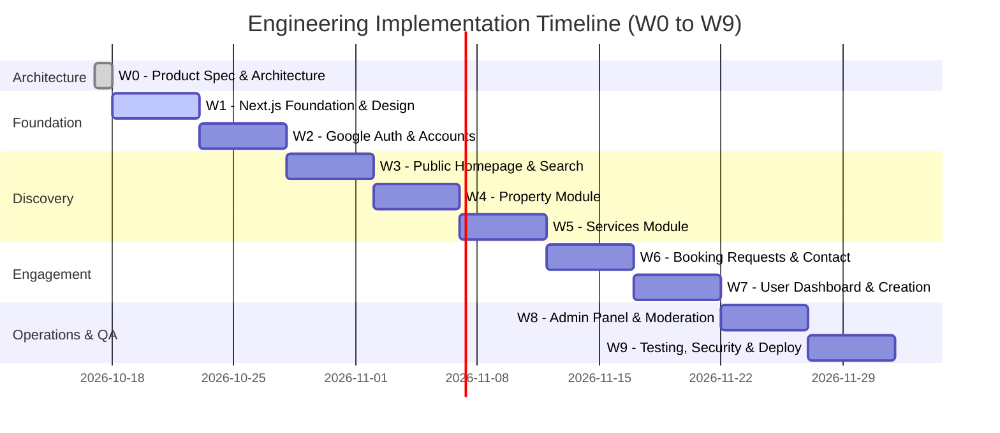

# Development Roadmap & Implementation Plan (W0 – W9)

## Document Information
- **Document Title**: Engineering Milestone Roadmap, Phase Deliverables & Completion Criteria
- **Phase**: W0 — Architecture & Product Specification
- **Version**: 1.0.0
- **Status**: Approved Baseline

---

## 1. Roadmap Overview & Timeline Phasing

The implementation sequence is structured into 10 cohesive weekly engineering milestones (W0 through W9). Each phase builds strictly on the deliverables, schemas, and specifications approved in previous phases.

---

## 2. Detailed Milestone Specifications

### Phase W0: Product Specification & Technical Architecture (Current Phase)
- **Primary Objective**: Establish definitive business requirements, technical specifications, database schemas, API contracts, security blueprints, and design tokens prior to writing code.
- **Scope**:
  - Comprehensive PRD, user flows, and site information architecture.
  - Complete MongoDB/Mongoose data model definitions with indexing plan.
  - Versioned REST API endpoints (`/api/v1/`) with Zod schemas.
  - Auth.js Google OAuth + database session security model.
  - Development roadmap and architecture documentation.
- **Dependencies**: None.
- **Deliverables**: All documents in `/docs` directory (`product-requirements.md`, `sitemap-and-user-flows.md`, `technical-architecture.md`, `database-schema.md`, `api-contracts.md`, `authentication-and-authorization.md`, `security-and-privacy.md`, `development-roadmap.md`, `README.md`).
- **Test Requirements**: Cross-document consistency verification; schema alignment check.
- **Completion Criteria**: Complete, mutually consistent documentation package approved and indexed.

---

### Phase W1: Next.js Foundation & Design System
- **Primary Objective**: Configure the technical core, database connection layer, Tailwind design system, and shared atomic UI component library.
- **Scope**:
  - Configure Tailwind CSS tokens matching approved color palette (`#214A3B`, `#E4EDE6`, `#EAE7F5`, `#F5F7F4`, `#202923`, `#68736C`).
  - Establish Mongoose database connection singleton (`src/lib/db.ts`).
  - Configure root layout, fonts, header navigation bar, city badge, and footer shell.
  - Build base UI primitives: Button, Input, Select, Badge, Card, Modal, Dialog, Skeleton, Toast notifications.
- **Dependencies**: W0 approved design tokens and directory structure.
- **Deliverables**:
  - `tailwind.config.ts` with custom color tokens.
  - `src/lib/db.ts` verified against local/Atlas MongoDB connection.
  - `src/components/ui/*` atomic component library.
  - `src/components/layout/Header.tsx`, `Footer.tsx`.
- **Test Requirements**: Unit testing of atomic UI components; visual regression check for color tokens; DB connection ping test.
- **Completion Criteria**: App compiles cleanly (`npm run build`), renders base layout shell, and successfully establishes a cached connection to MongoDB Atlas.

---

### Phase W2: Google Authentication & Accounts
- **Primary Objective**: Integrate Auth.js (NextAuth v5) with Google OAuth and MongoDB-backed database sessions.
- **Scope**:
  - Install and configure `@auth/mongodb-adapter` with Mongoose models.
  - Configure Google OAuth provider with client credentials.
  - Create `/auth/signin` page with approved styling.
  - Implement edge middleware protecting `/dashboard/*` and `/admin/*`.
  - Implement `/api/v1/users/me` endpoint for profile retrieval and updates.
  - Build user profile and account preferences page (`/account/profile`).
- **Dependencies**: W1 foundation and database connection.
- **Deliverables**:
  - `src/lib/auth.ts`, `src/middleware.ts`.
  - `src/app/api/auth/[...nextauth]/route.ts`.
  - User and Account Mongoose models (`src/models/User.ts`, `Account.ts`, `Session.ts`).
  - Profile settings page.
- **Test Requirements**: Successful Google OAuth login/logout flow; verification of database session creation in MongoDB; test unauthenticated redirect in middleware.
- **Completion Criteria**: Users can log in with Google, see their profile, update phone/WhatsApp details, and log out with complete session destruction.

---

### Phase W3: Public Homepage & Discovery Shell
- **Primary Objective**: Build the public landing page, dual-vertical search tabs, category carousels, and featured listing displays.
- **Scope**:
  - Dual-intent Hero Section with interactive tab switcher (Properties vs Services).
  - Quick category icons carousel for Services (Plumbing, Electrical, etc.).
  - Quick property type navigation (Apartment, House, PG, etc.).
  - Server-rendered "Featured Properties" and "Top Local Services" carousels.
  - Trust & Safety value proposition section.
- **Dependencies**: W1 UI components and Mongoose connection.
- **Deliverables**:
  - `src/app/(public)/page.tsx`.
  - `src/components/home/HeroSearch.tsx`.
  - `src/components/home/CategoryGrid.tsx`.
  - `src/components/home/FeaturedListings.tsx`.
- **Test Requirements**: Mobile-responsive layout validation; performance benchmark ensuring LCP < 1.5s; accessibility keyboard check.
- **Completion Criteria**: Homepage renders cleanly across mobile, tablet, and desktop viewports, with instant switching between property and service searches.

---

### Phase W4: Property Module (Search & Details)
- **Primary Objective**: Complete the public property browsing experience with multifaceted search, filters, and high-fidelity detail views.
- **Scope**:
  - Property search page (`/properties`) with sticky filter panel (purpose, price slider, BHK, furnishing, locality).
  - Property card component with thumbnail swiper, price badge, and spec chips.
  - Property detail page (`/properties/[id]`) with photo gallery lightbox, specs grid, amenities list, and floating contact card.
  - Direct contact action (Call and WhatsApp deep-link generation).
  - Rate-limited contact reveal endpoint (`/api/v1/listings/:id/contact-reveal`).
- **Dependencies**: W1 design tokens, W2 listing models.
- **Deliverables**:
  - `src/app/(public)/properties/page.tsx` & `[id]/page.tsx`.
  - `src/components/properties/PropertyFilters.tsx`, `PropertyCard.tsx`, `PropertyGallery.tsx`.
  - Contact unmasking integration.
- **Test Requirements**: Query filter accuracy across multiple criteria; rate-limiting verification on phone reveal (429 response after 15 calls).
- **Completion Criteria**: Visitors can search, filter, and inspect properties, and trigger direct phone or WhatsApp contact without page reload.

---

### Phase W5: Services Module (Search & Details)
- **Primary Objective**: Build the public service professional directory, category explorer, and provider profile views.
- **Scope**:
  - Service directory page (`/services`) with category pills, pricing model filters, and locality coverage search.
  - Service card component displaying provider avatar, verified badge, pricing badge, and service areas.
  - Service detail page (`/services/[id]`) featuring scope of work, portfolio images, pricing breakdown, and working hours.
  - Public provider profile page (`/providers/[id]`) aggregating all services by an individual professional.
- **Dependencies**: W1 components, W3 homepage categories.
- **Deliverables**:
  - `src/app/(public)/services/page.tsx` & `[id]/page.tsx`.
  - `src/app/(public)/providers/[id]/page.tsx`.
  - `src/components/services/ServiceFilters.tsx`, `ServiceCard.tsx`.
- **Test Requirements**: Service category filtering verification; pricing model tag rendering; responsiveness audit.
- **Completion Criteria**: Users can browse verified service offerings, evaluate provider credentials, and inspect pricing terms.

---

### Phase W6: Booking Requests & Direct Contact Flows
- **Primary Objective**: Implement the end-to-end appointment booking workflow for services and direct communication links.
- **Scope**:
  - Booking request modal on service detail pages with date picker (next 30 days) and time slot selector (`MORNING`, `AFTERNOON`, `EVENING`).
  - Booking API endpoint (`POST /api/v1/bookings`) with customer authentication guard.
  - Customer and Provider booking management hub (`/dashboard/bookings`).
  - Status transition controls: Provider Accept, Propose Reschedule, Decline, Complete.
  - Direct WhatsApp chat link generation with contextual pre-filled enquiry text.
- **Dependencies**: W2 auth sessions, W5 services module.
- **Deliverables**:
  - `src/components/bookings/BookingModal.tsx`.
  - `src/app/dashboard/bookings/page.tsx`.
  - `src/app/api/v1/bookings/route.ts` & `[id]/status/route.ts`.
  - `src/services/booking.service.ts`.
- **Test Requirements**: Booking state machine unit tests; date validation tests; authorization tests ensuring third parties cannot read or modify bookings.
- **Completion Criteria**: A customer can submit a booking request; the provider receives it in their queue, accepts or reschedules it, and the state accurately reflects across both dashboards.

---

### Phase W7: User Dashboard & Listing Creation
- **Primary Objective**: Build the listing creation suite and user management dashboard.
- **Scope**:
  - S3 / R2 presigned URL upload endpoint (`/api/v1/uploads/presigned-url`).
  - Multi-step Property Listing Creator (`/dashboard/listings/create-property`) with Zod validation.
  - Multi-step Service Listing Creator (`/dashboard/listings/create-service`) with portfolio uploads.
  - My Listings manager (`/dashboard/listings`) with Pause, Resume, Edit, and Delete actions.
  - Saved Listings / Favorites hub (`/dashboard/saved`) with instant bookmark toggle.
- **Dependencies**: W2 auth, W4 property models, W5 service models.
- **Deliverables**:
  - `src/app/dashboard/listings/create-property/page.tsx`.
  - `src/app/dashboard/listings/create-service/page.tsx`.
  - `src/app/dashboard/listings/page.tsx` & `saved/page.tsx`.
  - `src/components/listings/ImageUploader.tsx`.
- **Test Requirements**: Client and server Zod validation tests; direct image upload test to cloud storage; status transition test ensuring new listings enter `PENDING_REVIEW`.
- **Completion Criteria**: Users can upload photos, complete all required specs, and submit listings into the administrative moderation queue.

---

### Phase W8: Admin Panel & Moderation System
- **Primary Objective**: Deliver the administrative moderation dashboard, listing approval/rejection workflows, user management, and audit logging.
- **Scope**:
  - Admin layout shell with strict `role === 'ADMIN'` protection.
  - Moderation queue (`/admin/listings`) displaying pending submissions with side-by-side inspection drawer.
  - One-click Approve and Reject (with mandatory moderator reason) actions.
  - User Directory (`/admin/users`) with account suspension capability.
  - Reports Queue (`/admin/reports`) for handling user complaints.
  - Immutable Audit Log viewer (`/admin/audit-logs`).
- **Dependencies**: W2 auth RBAC, W7 listing creation.
- **Deliverables**:
  - `src/app/admin/page.tsx`, `listings/page.tsx`, `users/page.tsx`, `reports/page.tsx`, `audit-logs/page.tsx`.
  - `src/app/api/v1/admin/*` Route Handlers.
  - `src/services/admin.service.ts`.
- **Test Requirements**: RBAC penetration test ensuring non-admin users cannot access `/admin` or invoke admin APIs (403 Forbidden); verification of audit log generation on approval/rejection.
- **Completion Criteria**: Administrators can inspect submitted listings, approve them to make them live on the public site, or reject them with feedback, with every action logged in `auditLogs`.

---

### Phase W9: Testing, Security Hardening & Deployment
- **Primary Objective**: End-to-end integration testing, accessibility compliance, security header hardening, and production deployment preparation.
- **Scope**:
  - Comprehensive Playwright / Cypress E2E test suite covering the 10 core user flows.
  - WCAG 2.1 AA accessibility audit (contrast, keyboard focus, screen readers).
  - Security configuration: Content Security Policy, HSTS, rate-limiting stress testing.
  - Database index validation and query optimization in MongoDB Atlas.
  - Production build verification (`next build`) and environment variable validation.
- **Dependencies**: All previous phases (W0 through W8).
- **Deliverables**:
  - Automated test suites (`/tests/e2e/*`, `/tests/unit/*`).
  - Hardened `next.config.ts`.
  - Production deployment documentation and readiness checklist.
- **Test Requirements**: 100% pass rate on core user journey E2E tests; zero high/critical vulnerabilities on npm audit and ZAP security scans; Lighthouse score >= 90 across Performance, Accessibility, and Best Practices.
- **Completion Criteria**: Production application successfully deployed and accessible with live MongoDB Atlas and cloud object storage integrations.

---

## 3. Milestone Deliverables Summary Table

| Phase | Milestone Name | Key Functional Deliverables | Primary Technical Focus |
| :---: | :--- | :--- | :--- |
| **W0** | Architecture & Specifications | 8 specification documents + README | Analysis, system design, data modeling. |
| **W1** | Foundation & Design System | Atomic UI library, DB singleton, Layout shell | Tailwind palette tokens, Mongoose caching. |
| **W2** | Google Auth & Accounts | Sign-in page, user profile, DB sessions | Auth.js v5, MongoDB adapter, Edge middleware. |
| **W3** | Public Discovery & Home | Hero tabbed search, category carousels | Responsive RSC layouts, LCP optimization. |
| **W4** | Property Module | Property search, filters, details, contact | Faceted filtering, photo lightbox, rate limits. |
| **W5** | Services Module | Service directory, provider profiles | Category routing, pricing models, coverage tags. |
| **W6** | Bookings & Direct Contact | Booking modal, status tracking, WhatsApp | Booking state machine, WhatsApp deep links. |
| **W7** | User Dashboard & Creation | Multi-step listing creators, My Listings | Presigned S3 uploads, Zod form validation. |
| **W8** | Admin Panel & Moderation | Moderation queue, approve/reject, audit | Strict RBAC, immutable audit logging. |
| **W9** | Testing, Security & Deploy | E2E tests, CSP headers, Atlas optimization | Security audits, Lighthouse >= 90, deploy. |
