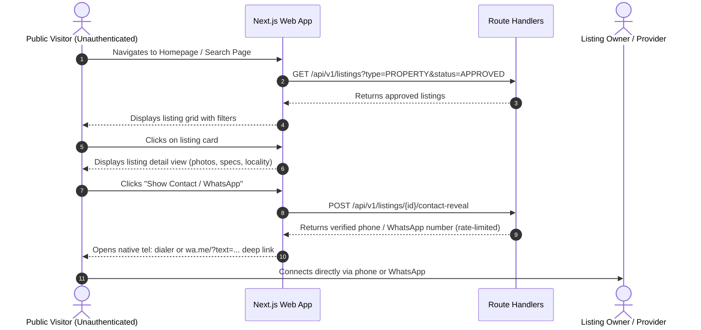
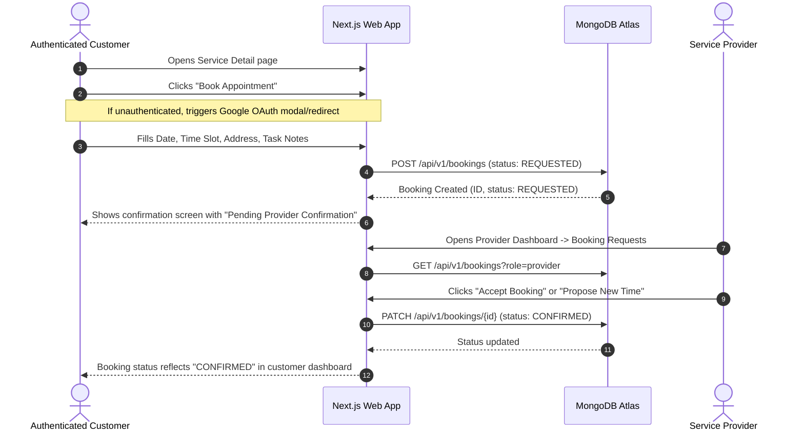

# Product Requirements Document (PRD)

## Document Information
- **Document Title**: Public Property & Local Services Marketplace — Product Specification
- **Phase**: W0 — Architecture & Product Specification
- **Version**: 1.0.0
- **Status**: Approved Baseline
- **Target Platform**: Web Application (Mobile-responsive Desktop & Tablet)

---

## 1. Executive Summary & Product Goals

The product is a unified public marketplace web application tailored for a single launch city (with an architecture designed for multi-city expansion). The platform provides equal prominence to two high-intent verticals:
1. **Real Estate & Living Spaces**: Properties available for purchase (Sale), lease (Rent), or shared accommodation (Paying Guest / Co-living).
2. **Skilled Professionals & Local Services**: Home repair, maintenance, trade craft, and on-demand local services.

### Core Value Propositions
- **Frictionless Public Discovery**: Zero barriers to search, explore, and evaluate listings. No mandatory registration or login is required to browse property details, service catalogues, or provider credentials.
- **Direct High-Trust Contact**: Eliminates clunky in-app chat systems in favor of real-world direct communication channels (Direct Phone Call and WhatsApp with structured pre-filled messaging), enabled at the owner/provider's discretion.
- **Provider-Confirmed Booking Requests**: Customers can submit structured service booking requests specifying their preferred date, time window, and scope of work, which providers review and confirm.
- **High-Integrity Quality Control**: Strict pre-publication administrative review (`PENDING_REVIEW` -> `APPROVED`) to eliminate spam, fraudulent property advertisements, duplicate listings, and unverified service claims.
- **Unified Single-Account Model**: A single authenticated user account (via Google OAuth) can seamlessly switch between roles—acting as a buyer/renter, a property owner/broker, a service customer, and a local trade provider.

---

## 2. Target User Personas

| User Persona | Key Motivations | Core Tasks & Needs | Pain Points to Solve |
| :--- | :--- | :--- | :--- |
| **Property Seeker (Buyer / Tenant / PG Guest)** | Find verified housing within budget and preferred locality without annoying paywalls. | Search with granular filters (rent/sale, BHK, furnishing), inspect photos, verify amenities, contact owner directly. | Hidden broker fees, fake/outdated listings, aggressive unsolicited spam calls. |
| **Property Owner / Broker** | List vacant properties and connect with genuine, serious tenants or buyers quickly. | Create property listings with photos, manage availability (Pause/Active), control phone/WhatsApp visibility. | Complicated listing forms, scam enquiries, spam bots scraping phone numbers. |
| **Service Seeker (Homeowner / Resident)** | Discover reliable local tradespeople and specialists (plumbers, electricians, cleaners, carpenters). | Browse verified services, compare pricing models, review credentials, book service appointments, or call directly. | Unresponsive service providers, opaque pricing, unreliable arrival times. |
| **Service Provider / Local Professional** | Attract local client leads, showcase expertise, and manage incoming service appointment requests. | Create service listings, configure service radius, receive structured booking requests, confirm/reschedule jobs. | High commission cuts from aggregators, missed calls while on a job, spam requests. |
| **Marketplace Administrator & Moderator** | Maintain marketplace trustworthiness, curate listings, protect users from fraud and inappropriate content. | Review listing submission queue, approve/reject listings with moderator feedback, manage reports, monitor platform health. | Manual review bottlenecks, malicious content, spam injection. |

---

## 3. Product Scope: Inclusions & Explicit MVP Exclusions

### 3.1 Included in MVP (Release 1.0)
- **Public Discovery & SEO**:
  - Full search, filter, and sorting for Properties and Services.
  - Dedicated SEO-friendly detail pages for both verticals.
  - Category exploration and featured listings on homepage.
- **Direct Communication**:
  - Click-to-call direct phone dialer integration.
  - Click-to-WhatsApp direct chat deep-link with dynamic pre-filled contextual messages.
  - Contact privacy controls (individual toggles for phone and WhatsApp visibility).
  - Rate-limited contact reveal mechanism to prevent automated web scraping.
- **Authentication & User Management**:
  - One-click Google OAuth authentication via Auth.js.
  - Persistent MongoDB database-backed sessions.
  - User profile management (display name, avatar, contact phone, contact WhatsApp).
- **Listing Creation & Management**:
  - Unified multi-step listing creator supporting both `PROPERTY` and `SERVICE` types.
  - Image uploading to cloud object storage with thumbnail generation.
  - Listing lifecycle management: Save Draft, Submit for Review, Pause, Reactivate, Archive.
- **Administrative Moderation**:
  - Dedicated admin portal for reviewing incoming listings (`PENDING_REVIEW`).
  - Approval and rejection workflows with moderator rejection reasons.
  - Content reporting and complaint submission for public users.
- **Service Booking Requests**:
  - Structured booking request submission (preferred date, preferred time slot, task description, service address).
  - Provider booking management dashboard (Accept, Decline, Propose New Time, Mark Completed).
- **Personal Activity**:
  - Saved/Favorite listings management.
  - My Listings dashboard with status indicators and quick actions.
  - Booking status tracking for both customer and service provider.

### 3.2 Explicit MVP Exclusions (Out of Scope for Phase 1)
- **No In-App Chat or Messaging Threads**: Communication is strictly off-platform via direct phone or WhatsApp. No real-time chat sockets, message databases, or inbox UIs.
- **No In-App Payments, Escrows, or Processing**: Zero financial transactions on-platform. Payments for properties and services are settled offline directly between the parties.
- **No Subscription Plans or Featured Listing Fees**: Monetization tiers, featured placement bidding, and paid listing boosts are deferred to Phase 2.
- **No Complex Real-Time Calendar Sync**: No two-way Google Calendar / Outlook sync or automated slot reservation. Appointments use a requested-and-confirmed workflow.
- **No Native Mobile Applications**: Scope is strictly limited to responsive web (PWA-ready web application). Native iOS and Android apps are out of scope.
- **No Multi-City Marketplace Operations**: Launch is confined to a single designated launch city (configured via environment/database constants), while maintaining city-agnostic database schemas for future expansion.

---

## 4. Core User Journeys

### Journey 1: Public Discovery to Direct Contact


### Journey 2: Service Booking Request & Provider Confirmation


### Journey 3: Listing Creation & Administrative Review
```mermaid
sequenceDiagram
    autonumber
    actor User as Authenticated User
    participant Web as Next.js Web App
    participant Storage as Cloud Object Storage
    participant DB as MongoDB Atlas
    actor Admin as Marketplace Administrator

    User->>Web: Navigates to "Create Listing"
    User->>Web: Selects Type: Property or Service
    User->>Web: Uploads photos directly via presigned URLs
    Web->>Storage: Direct client-to-storage PUT
    User->>Web: Completes details & submits
    Web->>DB: POST /api/v1/listings (status: PENDING_REVIEW)
    DB-->>Web: Listing saved in moderation queue
    Web-->>User: Notification: "Listing submitted for review (12-24h)"
    Admin->>Web: Accesses /admin/listings?status=PENDING_REVIEW
    Admin->>Web: Reviews photos, description, and pricing
    alt Listing Approved
        Admin->>Web: Clicks "Approve Listing"
        Web->>DB: PATCH /api/v1/admin/listings/{id} (status: APPROVED)
        DB-->>Web: Published to public index
    else Listing Rejected
        Admin->>Web: Enters rejection reason & clicks "Reject"
        Web->>DB: PATCH /api/v1/admin/listings/{id} (status: REJECTED, notes: "...")
        DB-->>Web: Listing flagged as rejected; hidden from public index
    end
```

---

## 5. Functional Requirements

### 5.1 Public Browsing & Search
- **FR-PUB-01**: Any visitor must be able to view the Homepage, Property listings index, Service listings index, and individual detail pages without authenticating.
- **FR-PUB-02**: Property search must support filtering by:
  - Listing Purpose (`FOR_SALE`, `FOR_RENT`, `PG_CO_LIVING`)
  - Property Type (`APARTMENT`, `INDEPENDENT_HOUSE`, `VILLA`, `COMMERCIAL`, `PLOT`)
  - Price Range (Min/Max price)
  - Number of Bedrooms (`1 BHK`, `2 BHK`, `3 BHK`, `4+ BHK`)
  - Furnishing status (`UNFURNISHED`, `SEMI_FURNISHED`, `FULLY_FURNISHED`)
  - Locality / Neighborhood keywords
  - Sort by: Newest first, Price: Low to High, Price: High to Low
- **FR-PUB-03**: Service search must support filtering by:
  - Service Category (`PLUMBING`, `ELECTRICAL`, `CARPENTRY`, `CLEANING`, `PAINTING`, `APPLIANCE_REPAIR`, `PEST_CONTROL`, `MOVERS_PACKERS`, `OTHER`)
  - Pricing Model (`FIXED`, `HOURLY`, `QUOTE_BASED`)
  - Starting Price Range (Min/Max)
  - Locality / Service Coverage Area
  - Sort by: Most Popular, Newest first, Starting Price: Low to High
- **FR-PUB-04**: Listing cards must display primary image thumbnail, title, pricing, location locality, badges (Property Type or Service Category), and quick-action buttons (Save, View Details).

### 5.2 Direct Contact Integration
- **FR-CNT-01**: When viewing a listing, contact buttons (Call / WhatsApp) must only be rendered if the listing owner has enabled the respective setting (`contactPreferences.showPhone`, `contactPreferences.showWhatsapp`).
- **FR-CNT-02**: Phone numbers must not be exposed in raw page HTML markup to automated web scrapers. Clicking "Call" must trigger a client-side reveal request (`/api/v1/listings/{id}/contact-reveal`) that logs the view and rate-limits the requester.
- **FR-CNT-03**: The WhatsApp action must generate a standardized deep-link URL formatted as:
  `https://wa.me/{countryCode}{phone}?text={encodedContextString}`
  Where the context string clearly identifies the listing:
  `"Hello, I am interested in your listing '{listingTitle}' on the Marketplace. Link: {listingUrl}. Is it still available?"`

### 5.3 Authentication & User Profiles
- **FR-AUTH-01**: Users must be able to sign in using Google OAuth with one click.
- **FR-AUTH-02**: Sessions must be stored in the MongoDB Atlas database using Auth.js database sessions with secure HTTP-only cookies.
- **FR-AUTH-03**: The user profile must track: Full Name, Email, Google Avatar URL, Contact Phone Number, WhatsApp Number, and Role (`USER` or `ADMIN`).
- **FR-AUTH-04**: Users must have access to an Account Settings page to update their contact details and preferences.

### 5.4 Listing Lifecycle & Publishing Workflow
- **FR-LST-01**: Authenticated users can create listings for either `PROPERTY` or `SERVICE`.
- **FR-LST-02**: Initial state for a newly submitted listing is always `PENDING_REVIEW`. Under no circumstances may a newly created listing bypass moderation.
- **FR-LST-03**: Status transitions for listings:
  - `DRAFT` -> User saving work-in-progress (private to owner).
  - `PENDING_REVIEW` -> User submits for admin moderation.
  - `APPROVED` -> Admin approves; listing becomes publicly searchable.
  - `REJECTED` -> Admin rejects with a mandatory reason; private to owner.
  - `PAUSED` -> Owner temporarily deactivates an approved listing (e.g., property rented out or provider on vacation). Hidden from public search.
  - `ARCHIVED` -> Owner or Admin permanently closes the listing.
- **FR-LST-04**: Editing an already `APPROVED` listing:
  - Edits to non-critical fields (e.g., minor description wording, contact availability toggles) update immediately.
  - Edits to critical fields (e.g., price increase > 50%, property category change, image replacement, address change) automatically re-trigger `PENDING_REVIEW` to prevent bait-and-switch fraud.

### 5.5 Service Booking System
- **FR-BKG-01**: Authenticated users can request an appointment for an active `SERVICE` listing.
- **FR-BKG-02**: The booking request must capture:
  - Preferred Service Date (must be in the future, up to 30 days ahead).
  - Preferred Time Slot (`MORNING` 9am-12pm, `AFTERNOON` 12pm-4pm, `EVENING` 4pm-8pm, or specific time).
  - Service Address / Customer Locality.
  - Brief description of the issue or requirement.
  - Customer contact phone number.
- **FR-BKG-03**: Booking status transitions:
  - `REQUESTED` -> Initial submission by customer.
  - `CONFIRMED` -> Provider accepts the requested date and time slot.
  - `RESCHEDULE_PROPOSED` -> Provider proposes an alternative date/time; awaiting customer confirmation.
  - `DECLINED` -> Provider declines the booking with an optional note.
  - `CANCELLED` -> Either customer or provider cancels before fulfillment.
  - `COMPLETED` -> Service job marked as successfully fulfilled.
- **FR-BKG-04**: Both Customer and Provider must receive visible status badges and timeline updates in their respective dashboards.

### 5.6 Moderation & Administrative Oversight
- **FR-ADM-01**: Admin dashboard must display a paginated moderation queue of all `PENDING_REVIEW` listings with submission timestamps and owner information.
- **FR-ADM-02**: Admin actions must include: One-click Approve, Reject with Reason, Flag for Re-edit, and Ban User.
- **FR-ADM-03**: Public users must have access to a "Report Listing" action with predefined violation categories (`SPAM`, `INACCURATE_PRICING`, `FAKE_PROPERTY`, `OFFENSIVE_CONTENT`, `OTHER`).
- **FR-ADM-04**: Admin portal must log all moderation actions in an immutable `auditLogs` collection.

---

## 6. Non-Functional Requirements (NFRs)

### 6.1 Performance & Responsiveness
- **NFR-PERF-01**: Initial page load (First Contentful Paint) for public discovery pages must be under 1.5 seconds on standard 4G broadband connections.
- **NFR-PERF-02**: Time to Interactive (TTI) must remain under 2.5 seconds.
- **NFR-PERF-03**: Server response time for API Route Handlers (`/api/v1/*`) must not exceed 200ms under standard operational load.
- **NFR-PERF-04**: Image assets must be served via optimized CDN in modern formats (`.webp`, `.avif`) with responsive `srcset` resolutions.

### 6.2 SEO & Web Indexing
- **NFR-SEO-01**: All public listing detail and search pages must render semantic HTML server-side (Next.js Server Components).
- **NFR-SEO-02**: Every listing detail page must dynamically output OpenGraph meta tags, Twitter card tags, canonical URLs, and Schema.org structured data (`RealEstateListing`, `SingleFamilyResidence`, or `LocalBusiness`).
- **NFR-SEO-03**: An automated `sitemap.xml` and `robots.txt` must be generated dynamically.

### 6.3 Security, Privacy & Compliance
- **NFR-SEC-01**: All data transmission must occur over TLS 1.3 / HTTPS.
- **NFR-SEC-02**: Sessions must use `HttpOnly`, `Secure`, `SameSite=Lax` cookies to prevent XSS access.
- **NFR-SEC-03**: User contact numbers must be shielded against bulk web scrapers using token-based rate limiting (maximum 15 reveals per user/IP per hour).
- **NFR-SEC-04**: All user inputs must be strictly validated server-side using Zod schemas with sanitization of rich text and string inputs to prevent XSS and NoSQL injection.
- **NFR-SEC-05**: Storage upload URLs must use short-lived presigned URLs (valid for <= 15 minutes) with strict content-type and file-size constraints (max 5MB per image).

### 6.4 Usability & Accessibility
- **NFR-ACC-01**: The UI must comply with WCAG 2.1 Level AA standards, ensuring a minimum contrast ratio of 4.5:1 for standard body text against the approved color palette.
- **NFR-ACC-02**: Full keyboard navigation support for all modals, filter drawers, dropdowns, and form inputs.
- **NFR-ACC-03**: Touch targets on mobile viewports must be at least 44x44 CSS pixels.

---

## 7. Feature Acceptance Criteria (Gherkin Format)

### Scenario 1: Public User Filters Properties by Locality and Price
```gherkin
Feature: Property Discovery and Filtering
  As a prospective tenant or buyer
  I want to filter property listings without logging in
  So that I can quickly find properties matching my budget and location

  Scenario: Filtering properties by BHK and maximum rent
    Given the marketplace has approved property listings
    And I am an unauthenticated visitor on the "/properties" page
    When I select "2 BHK" from the bedroom filter
    And I set the maximum price to 25000
    And I select listing purpose "FOR_RENT"
    Then the listing grid should update dynamically
    And only listings with 2 bedrooms, rent <= 25000, and status "APPROVED" should be displayed
    And the URL query parameters should reflect "?purpose=FOR_RENT&bedrooms=2&maxPrice=25000"
```

### Scenario 2: User Submits a Property Listing for Admin Review
```gherkin
Feature: Property Listing Submission
  As an authenticated property owner
  I want to submit my apartment details
  So that it can be reviewed and published to the marketplace

  Scenario: Successful submission triggers PENDING_REVIEW state
    Given I am signed in with my Google account
    When I navigate to "/listings/create-property"
    And I fill in all required property fields:
      | Title       | "Spacious 2BHK in Central Green" |
      | Purpose     | "FOR_RENT"                       |
      | Type        | "APARTMENT"                      |
      | Price       | 22000                            |
      | Bedrooms    | 2                                |
      | Bathrooms   | 2                                |
      | Area (sqft) | 1150                             |
      | Locality    | "Greenwood Valley"               |
    And I upload 3 valid interior photos
    And I enable WhatsApp contact visibility
    And I click "Submit for Moderation"
    Then a new listing document should be created in MongoDB with status "PENDING_REVIEW"
    And the listing should NOT appear in the public search results
    And I should see a success screen stating "Your listing has been submitted for review"
```

### Scenario 3: Admin Approves a Pending Listing
```gherkin
Feature: Administrative Listing Moderation
  As a marketplace administrator
  I want to review and approve submitted listings
  So that only verified, high-quality listings appear publicly

  Scenario: Admin approves a pending listing
    Given I am signed in with an account having role "ADMIN"
    And there is a property listing with status "PENDING_REVIEW"
    When I navigate to "/admin/listings"
    And I inspect the listing details and uploaded images
    And I click the "Approve" button
    Then the listing status should be updated to "APPROVED" in the database
    And an entry should be recorded in "auditLogs" documenting my action
    And the listing should immediately become visible on the public "/properties" index
```

### Scenario 4: Customer Requests a Service Booking
```gherkin
Feature: Service Booking Request
  As a customer
  I want to request a service appointment with a local plumber
  So that the plumber can confirm and schedule the job

  Scenario: Submitting a valid booking request
    Given I am signed in with my Google account
    And I am viewing an approved plumbing service listing
    When I click "Book Service"
    And I select a future date 3 days from today
    And I select the "MORNING" time slot
    And I provide my service address and problem description
    And I click "Confirm Booking Request"
    Then a new booking document should be created with status "REQUESTED"
    And the booking should appear in my "/dashboard/bookings" page as "Pending Confirmation"
    And the service provider should see the request in their provider booking queue
```

---

## 8. Launch Geography & Multi-City Extensibility

### Single-City Launch Configuration
The application will launch in one specified city (e.g., configured via `NEXT_PUBLIC_LAUNCH_CITY_NAME` and `LAUNCH_CITY_CODE`).
- All default searches, locality auto-completes, and filters default to this city.
- The UI will explicitly display the active city in the navigation header.

### Multi-City Architectural Provisions
The data schema and business layer will NOT hardcode a single city. Instead:
1. Every listing document contains a normalized `city` field (e.g., `{ name: string, code: string, state: string }`).
2. Search and aggregation queries accept `city` as a top-level filter parameter.
3. Geo-coordinates (`location.coordinates: [longitude, latitude]`) are indexed via 2dsphere indexes.
4. When additional cities are launched, no database schema migration will be required—simply updating the city selector component and allowing multi-city selection in queries.
