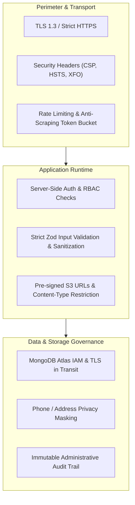

# Security, Privacy & Threat Mitigation Architecture

## Document Information
- **Document Title**: Security Policies, Threat Vectors, Privacy Safeguards & Data Governance
- **Phase**: W0 — Architecture & Product Specification
- **Version**: 1.0.0
- **Status**: Approved Baseline

---

## 1. Threat Modeling & Security Perimeter

The marketplace processes real-world user identities, physical property addresses, contact phone numbers, and booking schedules. The platform employs a defense-in-depth posture across all layers.



---

## 2. Authentication & Session Security

1. **HttpOnly & Secure Cookies**:
   - Session tokens are stored in cookies flagged with `HttpOnly` (inaccessible to JavaScript `document.cookie`), `Secure` (transmitted only over HTTPS), and `SameSite=Lax` (defends against Cross-Site Request Forgery / CSRF).
2. **Session Hijacking Mitigation**:
   - Cryptographically random session identifiers (32+ bytes entropy).
   - Session tokens are mapped to user IDs in the database and validated on every authenticated transaction.
   - User-Agent and IP tracking can be optionally checked for anomalous geographic shifts.
3. **Session Invalidation on Privilege Change**:
   - When an account is suspended or role updated, the server purges all associated documents in the `sessions` collection.

---

## 3. Contact & Location Privacy Safeguards

### 3.1 Scraping Protection: Rate-Limited Contact Reveal
A major risk for open marketplaces is automated scraping bots indexing owner phone numbers for spam marketing.
- **Privacy Rule**: Raw telephone and WhatsApp numbers are **never rendered in initial server-side HTML markup** for public listings.
- **Unmasking Protocol**:
  - The client displays an active CTA: `[Reveal Phone / Call Owner]`.
  - Clicking sends a POST request to `/api/v1/listings/:id/contact-reveal`.
  - The endpoint verifies the requester's IP/Session against a rate limit (maximum 15 reveals per hour).
  - Upon passing the limit, the verified number is returned and logged in `metrics.contactReveals`.
  - Exceeding the threshold returns `429 Too Many Requests` with a human cooldown message.

### 3.2 Granular Owner Contact Controls
Every listing respects independent toggles configured by the creator:
- `contactPreferences.showPhone`: If `false`, phone reveal is disabled; no dialer is exposed.
- `contactPreferences.showWhatsapp`: If `false`, WhatsApp messaging deep link is suppressed.
- If both are `false`, contact can only be initiated via service booking requests (for services) or the listing is informational only.

### 3.3 Public vs Private Location Data
- **Public Locality**: The public listing search and detail view displays only the city name, locality/neighborhood (e.g., *"Greenwood Valley"*), and landmark.
- **Private Specific Address**: Exact building number, flat/unit number, and private street address (`location.streetAddress`) are hidden from unauthenticated and general search visitors.
- **Service Bookings**: Exact customer residential address is disclosed **only** to the specific service provider after the booking request has been submitted.

---

## 4. Input Validation, Injection Prevention & Sanitization

### 4.1 Strict Schema Enforcement with Zod
- Every incoming payload to Route Handlers is stripped of unknown attributes using `zodSchema.parse()` or `safeParse()`.
- Stripping extraneous fields guarantees that malicious actors cannot inject forbidden parameters (e.g., attempting to pass `role: 'ADMIN'` during registration or `status: 'APPROVED'` during listing creation).

### 4.2 Cross-Site Scripting (XSS) Prevention
- User-supplied text fields (listing titles, descriptions, customer notes) are treated as untrusted strings.
- React inherently escapes JSX bindings by default.
- In instances where formatted descriptions are rendered, an aggressive HTML sanitizer (e.g., `sanitize-html` or `DOMPurify`) strips all `<script>`, `<iframe>`, `object`, `onload`, and inline event attributes.

### 4.3 NoSQL Injection Defense
- Mongoose schema typing automatically casts and sanitizes inputs, preventing operator injection attacks (e.g., passing `{ "$gt": "" }` in JSON bodies).
- MongoDB query selectors strictly sanitize query terms before executing database operations.

---

## 5. Media Upload Security & Cloud Storage Architecture

Accepting user file uploads introduces vectors for malware hosting, server disk exhaustion, and arbitrary script execution. The architecture eliminates these risks through direct-to-cloud presigned transfers:

1. **Zero Server Binary Transit**: Files never touch the Next.js application server memory or local filesystem.
2. **Presigned Upload Authorization**:
   - The client requests a presigned URL via `/api/v1/uploads/presigned-url`.
   - The server validates that the user is authenticated.
   - Enforces an allowlist of MIME types: `['image/jpeg', 'image/png', 'image/webp']`. SVGs and executable files (`.exe`, `.sh`, `.html`, `.js`) are strictly forbidden.
   - Enforces a maximum file size constraint of **5 Megabytes** (5,242,880 bytes).
3. **Storage Bucket Hardening**:
   - The S3 / R2 storage bucket disables public object uploads; writes are permitted exclusively via signed authorization headers.
   - Content-Disposition is forced to `inline` with explicitly set `Content-Type`.
   - Uploaded files are assigned cryptographically random UUID keys (e.g., `listings/f81d4fae-7dec-11d0-a765-00a0c91e6bf6.webp`), discarding the original client filename to prevent directory traversal attacks.

---

## 6. Access Control & Authorization Boundaries

### 6.1 Listing Ownership Enforcement
- Every write or status change to a listing validates:
  `assertOwnership(listing.ownerId, session)`
- If `listing.ownerId !== session.user.id` and `session.user.role !== 'ADMIN'`, the request immediately terminates with `403 Forbidden`.

### 6.2 Booking Confidentiality Perimeter
Booking records contain customer residential addresses and phone numbers. Access to a booking document is strictly limited to three parties:
1. The customer who initiated the request (`customerId === session.user.id`).
2. The service provider assigned to the listing (`providerId === session.user.id`).
3. An authenticated administrator (`session.user.role === 'ADMIN'`).
Any other user requesting access receives `404 Not Found` (to avoid confirming the existence of the booking ID).

---

## 7. HTTP Security Headers Specification

The Next.js configuration (`next.config.ts`) injects standard security headers into all responses:

```typescript
// next.config.ts security headers
const securityHeaders = [
  {
    key: 'X-DNS-Prefetch-Control',
    value: 'on',
  },
  {
    key: 'Strict-Transport-Security',
    value: 'max-age=63072000; includeSubDomains; preload',
  },
  {
    key: 'X-Content-Type-Options',
    value: 'nosniff',
  },
  {
    key: 'X-Frame-Options',
    value: 'DENY',
  },
  {
    key: 'Referrer-Policy',
    value: 'origin-when-cross-origin',
  },
  {
    key: 'Permissions-Policy',
    value: 'camera=(), microphone=(), geolocation=(self)',
  },
  {
    key: 'Content-Security-Policy',
    value: `
      default-src 'self';
      script-src 'self' 'unsafe-inline' 'unsafe-eval' https://accounts.google.com;
      style-src 'self' 'unsafe-inline' https://fonts.googleapis.com;
      img-src 'self' data: blob: https://media.marketplace.com https://lh3.googleusercontent.com;
      font-src 'self' https://fonts.gstatic.com;
      connect-src 'self' https://accounts.google.com https://*.r2.cloudflarestorage.com;
      frame-src https://accounts.google.com;
    `.replace(/\s{2,}/g, ' ').trim(),
  },
];
```

---

## 8. Data Retention, Account Deletion & Right to Be Forgotten

In compliance with modern privacy standards (GDPR / Indian DPDP Act principles):
1. **User Account Erasure**:
   - When a user selects "Delete My Account", the system triggers an atomic soft-delete procedure:
     - Sets `status: 'DELETED'`, `deletedAt: new Date()`.
     - Anonymizes `email` (e.g., `deleted_user_653b1...@marketplace.internal`).
     - Clears `name`, `phone`, `whatsapp`, and Google avatar URL.
     - Immediately purges active sessions from the `sessions` collection.
2. **Associated Listing Lifecycle**:
   - All active listings owned by the user are transitioned to `status: 'ARCHIVED'`.
   - Archived listings are permanently excluded from public search queries.
3. **Historical Integrity**:
   - Completed bookings and audit logs retain non-personally-identifiable ledger references to maintain operational auditability.

---

## 9. Error Handling & Information Disclosure Hygiene

1. **No Production Stack Traces**:
   - Server errors in production never expose Mongoose query dumps, database connection strings, or system file paths.
   - The client receives a sanitized error envelope:
     ```json
     {
       "success": false,
       "error": {
         "code": "INTERNAL_SERVER_ERROR",
         "message": "An unexpected error occurred. Please quote Trace ID: req_9a8b7c to support."
       }
     }
     ```
2. **Correlation Trace IDs**:
   - Every request is tagged with a unique request ID (`x-request-id`), passed through to log aggregators for internal debugging without exposing sensitive internals to the end user.
