# Sitemap, Page Specifications & User Flows

## Document Information
- **Document Title**: Sitemap, Information Architecture, Page Specifications & User Flows
- **Phase**: W0 — Architecture & Product Specification
- **Version**: 1.0.0
- **Status**: Approved Baseline

---

## 1. Information Architecture & Complete Sitemap

```mermaid
graph TD
    Root["/ (Root Domain)"]
    
    %% Public Routes
    Root --> Home["/ (Homepage)"]
    Root --> Properties["/properties (Property Discovery)"]
    Properties --> PropertyDetail["/properties/[id] (Property Details)"]
    Root --> Services["/services (Service Discovery)"]
    Services --> ServiceDetail["/services/[id] (Service Details)"]
    Root --> ProviderProfile["/providers/[id] (Public Provider Profile)"]
    Root --> About["/about (About Marketplace)"]
    Root --> Contact["/contact (Support & Help)"]
    Root --> Privacy["/privacy (Privacy Policy)"]
    Root --> Terms["/terms (Terms of Service)"]
    
    %% Auth Routes
    Root --> AuthSignIn["/auth/signin (Sign In Entry Point)"]
    Root --> AuthCallback["/api/auth/callback/google (OAuth Callback)"]
    Root --> AuthSignOut["/auth/signout (Sign Out Handler)"]
    
    %% Authenticated User Routes
    Root --> Dashboard["/dashboard (User Hub)"]
    Dashboard --> MyListings["/dashboard/listings (My Listings)"]
    Dashboard --> CreateProperty["/dashboard/listings/create-property"]
    Dashboard --> CreateService["/dashboard/listings/create-service"]
    Dashboard --> EditListing["/dashboard/listings/edit/[id]"]
    Dashboard --> SavedListings["/dashboard/saved (Saved Favorites)"]
    Dashboard --> Bookings["/dashboard/bookings (Bookings: Customer & Provider)"]
    Dashboard --> Profile["/account/profile (Account & Preferences)"]
    
    %% Admin Routes
    Root --> Admin["/admin (Admin Console)"]
    Admin --> AdminQueue["/admin/listings (Moderation Queue)"]
    Admin --> AdminUsers["/admin/users (User Directory)"]
    Admin --> AdminReports["/admin/reports (User Complaints)"]
    Admin --> AdminCategories["/admin/categories (Categories & Tags)"]
    Admin --> AdminAudit["/admin/audit-logs (Audit Logs)"]
```

---

## 2. Comprehensive Page Specifications

### 2.1 Public Pages

#### 1. Homepage (`/`)
- **Purpose**: Welcomes visitors, establishes value proposition, enables instant dual-vertical search (Properties & Services), and features curated high-quality listings.
- **Access Level**: Public (No authentication required).
- **Main Components**:
  - Global Navigation Header (Logo, City Selector badge, Search Bar, "Explore Properties", "Find Services", "Post Listing" button, Google Sign-in button / Avatar menu).
  - Dual-Intent Hero Section with toggling search tabs (`Find a Home` vs `Find a Service`).
  - Quick Category Carousel for Services (Plumbing, Electrical, Carpentry, Cleaning, etc.).
  - Quick Property Types Grid (Apartment, Independent House, Villa, PG / Co-living, Commercial).
  - Featured Properties Grid (Top approved property cards).
  - Top-Rated Local Professionals Grid (Top approved service cards).
  - Trust & Safety Section (Direct WhatsApp contact, Verified listings, Zero platform fees).
  - Global Footer (Legal links, City information, Category directories, Copyright).
- **Actions**:
  - Switch hero search between Property and Service tabs.
  - Execute keyword + locality search.
  - Click on any property or service card to navigate to detail view.
  - Click "Save" icon on cards (triggers Google OAuth prompt if unauthenticated).
- **Loading State**: Full-page skeleton displaying animated grey bounding boxes for hero search, category icons, and listing card carousels.
- **Empty State**: N/A (Static marketing sections and pre-rendered featured carousels).
- **Error State**: Displays global error boundary (`error.tsx`) with "Unable to load homepage content. [Retry]" button.

#### 2. Property Search & Results (`/properties`)
- **Purpose**: Full-featured exploratory search interface for properties (Sale, Rent, PG) with granular facet filtering.
- **Access Level**: Public.
- **Main Components**:
  - Sticky Top/Side Filter Bar:
    - Purpose selector (`All`, `For Rent`, `For Sale`, `PG / Co-Living`).
    - Property Type multi-select checkboxes (`Apartment`, `House`, `Villa`, `Plot`, `Commercial`).
    - Price Slider / Min-Max input fields.
    - Bedroom count pill buttons (`1 BHK`, `2 BHK`, `3 BHK`, `4+ BHK`).
    - Furnishing selector (`Furnished`, `Semi-Furnished`, `Unfurnished`).
    - Locality / Neighborhood search input.
  - Sort Dropdown (`Newest`, `Price: Low to High`, `Price: High to Low`).
  - Active Filters Chips (with one-click "Clear All").
  - Responsive Results Grid (3 columns on desktop, 2 on tablet, 1 on mobile).
  - Pagination Controls (Previous / Next / Page numbers).
- **Actions**:
  - Filter adjustment (synchronizes state via URL search parameters).
  - Sorting adjustment.
  - Card hover (displays image carousel controls).
  - Click listing card to view details.
  - Favorite/Save toggle on card.
- **Loading State**: Filter sidebar rendered, results grid replaced with 6 shimmering skeleton cards simulating property photo, badge, title, price, and locality.
- **Empty State**: Graphic illustration with message: "No properties found matching your criteria. Try adjusting your filters or price range." with a "Reset All Filters" CTA.
- **Error State**: In-line error banner: "Failed to fetch property listings. Please check your network connection and click to retry."

#### 3. Property Detail View (`/properties/[id]`)
- **Purpose**: Displays comprehensive specifications, verified photos, owner contact options, and neighborhood information for an individual property.
- **Access Level**: Public.
- **Main Components**:
  - Breadcrumbs navigation (`Home > Properties > Rent > 2BHK Apartment in Greenwood`).
  - Hero Image Gallery (Grid view on desktop with full-screen lightbox modal; swipeable carousel on mobile).
  - Header Info: Title, Badge (`For Rent` / `For Sale`), Price (with "/month" or "Total"), Deposit/Maintenance info, Locality & City.
  - Key Specs Bar: Bedrooms, Bathrooms, Carpet Area (sqft), Furnishing Status, Available From date, Floor number.
  - Detailed Description block (clean typography with line breaks).
  - Amenities & Highlights Grid (Icons with labels: Lift, Power Backup, Security, Covered Parking, Water Supply).
  - Approximate Location Map / Neighborhood overview.
  - Floating Contact Card (Desktop sidebar / Mobile bottom sticky sheet):
    - Owner / Broker Name & Verification badge.
    - "Call Owner" button (opens native dialer after contact reveal).
    - "Chat on WhatsApp" button (opens WhatsApp with pre-filled listing link and context).
    - "Save to Favorites" button.
    - "Report Listing" link.
- **Actions**:
  - Browse photos in high-res modal.
  - Click "Call" (triggers rate-limited reveal API).
  - Click "WhatsApp" (triggers direct deep link).
  - Save to favorites (prompts login if guest).
  - Open "Report Listing" modal.
- **Loading State**: Hero gallery skeleton, text line placeholders, and blank sidebar card with pulsing loader.
- **Empty State**: Returns Next.js standard 404 (`not-found.tsx`): "Listing not found or has been removed by the owner."
- **Error State**: Displays 500 error boundary: "Unable to load property details. Please try again."

#### 4. Service Search & Results (`/services`)
- **Purpose**: Explore local service professionals, repair specialists, and trade craft across approved categories.
- **Access Level**: Public.
- **Main Components**:
  - Category Pills Bar (Horizontal scroll on mobile, wrap on desktop): All, Plumbing, Electrical, Carpentry, Painting, Cleaning, Appliances, etc.
  - Filter Panel:
    - Pricing Model (`Fixed Rate`, `Hourly Rate`, `Quote Based`).
    - Starting Price range.
    - Locality / Service Coverage.
  - Sort By: `Top Rated`, `Newest`, `Price: Low to High`.
  - Service Cards Grid: Provider name, avatar, service title, category badge, pricing badge, coverage area, and quick "Book" or "Contact" buttons.
- **Actions**:
  - Filter by category and locality.
  - Click card to open Service Detail.
  - Click "Book" to launch quick-booking modal (prompts login if guest).
- **Loading State**: Category pill skeletons and 6 service card skeletons showing avatar circle, title line, and price chip.
- **Empty State**: "No service providers found in this category or locality. Are you a local professional? [List your service today]."
- **Error State**: Error banner with reload action.

#### 5. Service Detail View (`/services/[id]`)
- **Purpose**: Deep-dive into a service offering: provider background, pricing structures, coverage areas, service photos/past work, and booking request form.
- **Access Level**: Public (Booking action requires authentication).
- **Main Components**:
  - Provider Header: Name, profile picture, primary trade category, verified badge, years of experience.
  - Service Overview: Title, descriptive scope of work, tools provided, guarantees.
  - Portfolio / Past Work Gallery (Images of completed installations/repairs).
  - Pricing & Terms:
    - Base inspection/visit fee (if applicable).
    - Hourly or Fixed rate breakdown.
    - Material procurement policy.
  - Service Area & Availability: List of covered neighborhoods/localities, working hours (e.g., Mon–Sat: 8 AM – 8 PM).
  - Action Panel (Sticky sidebar on desktop, sticky footer on mobile):
    - Primary CTA: "Request Service Booking" (primary green button).
    - Secondary CTA: "Call Provider" & "WhatsApp Provider" (conditional on provider preference).
    - Save Service toggle.
- **Actions**:
  - Click "Request Service Booking" -> Opens booking request modal.
  - Click "Call" or "WhatsApp" -> Contact provider directly.
  - Click "Report Listing".
- **Loading State**: Full layout skeleton with pulsing elements.
- **Empty State**: 404 Not Found if invalid ID or inactive status.
- **Error State**: Error boundary with fallback message.

#### 6. Public Provider Profile (`/providers/[id]`)
- **Purpose**: Consolidates all services offered by a single verified service professional or business entity.
- **Access Level**: Public.
- **Main Components**:
  - Provider Bio Card: Avatar, business name, bio, verified phone/WhatsApp badges, member since date.
  - Active Service Offerings Grid: Cards for each active service listing created by this provider.
  - Coverage Map & Working Hours.
- **Actions**:
  - View individual services.
  - Direct call or WhatsApp initiation.
- **Loading State**: Profile header skeleton + cards skeleton.
- **Empty State**: "This provider currently has no active public listings."
- **Error State**: 404 if user ID does not exist or has no approved services.

#### 7. Authentication Entry Points (`/auth/signin`, `/auth/signout`)
- **Purpose**: Clean authentication interface explaining the benefits of signing in and initiating the Google OAuth handshake.
- **Access Level**: Public.
- **Main Components**:
  - Clean card centered on screen with approved branding.
  - Value bullet points: "Save your favorite listings", "Manage your property & service ads", "Track service booking requests".
  - Prominent "Continue with Google" button with official Google logo.
  - Terms and Privacy disclaimer.
- **Actions**:
  - Click "Continue with Google" -> Triggers Auth.js OAuth redirect to Google accounts.
  - Post-auth redirect back to original referral URL (`callbackUrl`).
- **Loading State**: Spinning loading state on button with disabled interaction during redirect.
- **Error State**: Displays alert banner if OAuth failed (`?error=OAuthCallback`, `?error=AccessDenied`).

---

### 2.2 Authenticated User Pages

#### 8. User Dashboard & Activity Hub (`/dashboard`)
- **Purpose**: Centralized home for authenticated users to monitor their listings, booking requests, and saved items.
- **Access Level**: Authenticated User (`USER` or `ADMIN`).
- **Main Components**:
  - User Welcome Banner with Google Avatar, Name, and Email.
  - Metrics Cards: "Active Listings", "Pending Reviews", "Incoming Bookings", "Saved Items".
  - Quick Actions Bar: "+ Post a Property", "+ Post a Service", "View Bookings".
  - Recent Activity Feed: Latest status updates on listings or booking requests.
- **Actions**:
  - Navigate directly to sub-sections (Listings, Bookings, Saved, Profile).
- **Loading State**: 4 metrics card skeletons + table skeleton.
- **Empty State**: Friendly onboarding cards: "You haven't listed any properties or requested any services yet. [Get Started]."
- **Error State**: Session verification error triggers auto-redirect to `/auth/signin`.

#### 9. My Listings (`/dashboard/listings`)
- **Purpose**: Manage, edit, pause, and monitor the review status of all user-created properties and services.
- **Access Level**: Authenticated User (Owner).
- **Main Components**:
  - Segmented Tabs: `All Listings`, `Properties`, `Services`.
  - Filter by Status: `All`, `Approved`, `Pending Review`, `Rejected`, `Paused`, `Draft`.
  - Listings Table / Cards:
    - Listing thumbnail, title, category/type, price, submission date.
    - Status Badge with color coding:
      - `APPROVED`: Solid Green (`#214A3B` / `#E4EDE6`)
      - `PENDING_REVIEW`: Solid Amber/Yellow
      - `REJECTED`: Solid Crimson Red (with clickable tooltip to view rejection reason)
      - `PAUSED`: Muted Grey
    - Quick Action Menu (`...`): Edit Listing, Pause / Resume, View Public Page, Delete / Archive.
- **Actions**:
  - Pause active listing (instantly removes from public search without deleting).
  - Resume paused listing.
  - Click "Edit" -> Navigates to edit form.
  - Delete listing (with confirmation modal).
- **Loading State**: Table row skeletons.
- **Empty State**: "You don't have any listings yet. Create your first property or service listing in minutes!" with buttons: [Create Property] [Create Service].
- **Error State**: Standard error boundary.

#### 10. Create / Edit Property Listing (`/dashboard/listings/create-property`, `/dashboard/listings/edit/[id]`)
- **Purpose**: Form interface for drafting and submitting property listings for admin review.
- **Access Level**: Authenticated User (Owner or Admin).
- **Main Components**:
  - Multi-step Progress Stepper (Step 1: Basic Info & Purpose, Step 2: Specs & Pricing, Step 3: Photos & Amenities, Step 4: Contact & Review).
  - Form Fields with Real-time Zod validation:
    - Purpose (`FOR_SALE`, `FOR_RENT`, `PG_CO_LIVING`).
    - Property Type, Title, Description.
    - Monthly Rent / Sale Price, Security Deposit, Maintenance Fee.
    - Bedrooms, Bathrooms, Balconies, Super Area, Carpet Area.
    - Furnishing, Available Date, Preferred Tenants (Family, Bachelors, Any).
    - Locality, Landmark, Street Address (private).
  - Image Upload Dropzone: Drag-and-drop photos (up to 10 images), reorder primary image thumbnail, delete preview.
  - Contact Visibility Toggles:
    - [x] Show phone number on listing
    - [x] Allow direct WhatsApp enquiries
  - Submission Actions: "Save as Draft" and "Submit for Review".
- **Actions**:
  - Upload images directly to cloud storage.
  - Validate form fields.
  - Submit listing (transitions status to `PENDING_REVIEW`).
- **Loading State**: Form skeleton or button spinner on submit.
- **Empty State**: N/A.
- **Error State**: In-line validation error callouts under each invalid field; banner on server submission failure.

#### 11. Create / Edit Service Listing (`/dashboard/listings/create-service`, `/dashboard/listings/edit/[id]`)
- **Purpose**: Form interface for tradespeople and professionals to list their services.
- **Access Level**: Authenticated User.
- **Main Components**:
  - Stepper: Step 1: Category & Scope, Step 2: Pricing & Experience, Step 3: Service Area, Step 4: Portfolio Photos & Contact.
  - Form Fields:
    - Category dropdown (Plumbing, Electrical, Carpentry, etc.).
    - Service Title, Detailed Scope Description, Tools/Equipment provided.
    - Pricing Model (`FIXED`, `HOURLY`, `QUOTE_BASED`), Starting Price.
    - Years of Experience, Certifications/Licenses.
    - Service Localities (Multi-select tags of covered neighborhoods).
    - Working Days & Hours.
  - Portfolio Image Uploads (up to 8 images of past work).
  - Contact Visibility Toggles (Phone / WhatsApp).
- **Actions**:
  - Submit for review -> Status `PENDING_REVIEW`.
- **Loading State**: Skeleton form with field loaders.
- **Error State**: In-line validation messages.

#### 12. Saved Listings / Favorites (`/dashboard/saved`)
- **Purpose**: Personal bookmark collection of saved properties and services.
- **Access Level**: Authenticated User.
- **Main Components**:
  - Filter Tabs: `All Saved`, `Properties`, `Services`.
  - Grid of saved listing cards.
  - Unsave button on each card (removes item from list with undo toast).
- **Actions**:
  - Click to view details.
  - Unsave.
- **Loading State**: 4 card skeletons.
- **Empty State**: "You haven't saved any listings yet. Browse properties and services to save your favorites for quick access." [Browse Properties] [Find Services].
- **Error State**: Error banner with retry.

#### 13. Booking Requests & History (`/dashboard/bookings`)
- **Purpose**: Unified booking center managing both:
  - "Bookings I Requested" (Customer view)
  - "Incoming Service Requests" (Provider view)
- **Access Level**: Authenticated User.
- **Main Components**:
  - Role Switcher Tabs: `My Requests (As Customer)` vs `Incoming Requests (As Provider)`.
  - Status Filter: `All`, `Requested`, `Confirmed`, `Rescheduled`, `Completed`, `Cancelled`.
  - Booking Card:
    - Service title, Provider / Customer name & phone.
    - Scheduled Date & Time Window badge.
    - Service Location / Address.
    - Customer note / problem description.
    - Status badge (`REQUESTED`, `CONFIRMED`, `DECLINED`, etc.).
    - Contextual Action Buttons:
      - For Provider on `REQUESTED`: [Accept Booking] [Propose New Time] [Decline]
      - For Customer on `RESCHEDULE_PROPOSED`: [Accept New Time] [Decline]
      - For Either on `CONFIRMED`: [Cancel Booking] [Mark as Completed]
- **Actions**:
  - Status mutation via dialog modals.
  - Direct call/WhatsApp to counterpart.
- **Loading State**: Booking list skeleton.
- **Empty State**: "No booking requests found in this view."
- **Error State**: Standard error boundary.

#### 14. Profile & Account Settings (`/account/profile`)
- **Purpose**: Manage personal identity, default contact numbers, notification preferences, and account deletion.
- **Access Level**: Authenticated User.
- **Main Components**:
  - Google Account Info (Avatar, Email - read-only from Google provider).
  - Editable Contact Details: Display Name, Primary Phone Number, WhatsApp Number.
  - Privacy Preferences: Default contact visibility for new listings.
  - Danger Zone: "Delete My Account" button (initiates soft delete & unlinking flow).
- **Actions**:
  - Save profile changes.
  - Initiate account deletion.
- **Loading State**: Form field loaders.
- **Empty State**: N/A.
- **Error State**: Validation alerts.

---

### 2.3 Administrative Pages

#### 15. Admin Dashboard (`/admin`)
- **Purpose**: Executive overview of platform health, listing moderation velocity, user activity, and pending alerts.
- **Access Level**: Administrator (`role === 'ADMIN'`).
- **Main Components**:
  - KPI Stat Cards: "Listings Pending Review", "Approved Properties", "Approved Services", "Total Users", "Open User Reports".
  - Urgent Moderation Queue Preview: Top 5 oldest pending listings awaiting review.
  - Recent Administrative Activity Feed.
- **Actions**:
  - Quick link to full moderation queue or reports queue.
- **Loading State**: Stat cards skeleton.
- **Empty State**: "All moderation queues are clear! Zero pending listings."
- **Error State**: 403 Forbidden for non-admin users.

#### 16. Listing Moderation Queue (`/admin/listings`)
- **Purpose**: Primary moderation hub to inspect, verify, approve, or reject newly submitted and edited listings.
- **Access Level**: Administrator.
- **Main Components**:
  - Status Filters: `PENDING_REVIEW` (default), `APPROVED`, `REJECTED`, `PAUSED`.
  - Type Filter: `All`, `Property`, `Service`.
  - Inspection Drawer / Detail Modal:
    - Side-by-side view of submitted images, title, price, description, and contact info.
    - Automated flags (e.g., suspicious keywords, extreme price deviation).
    - Quick Action Buttons:
      - [Approve Listing] (Turns status to `APPROVED`).
      - [Reject Listing] (Opens modal requiring a clear rejection reason).
      - [Flag for Owner Re-edit].
- **Actions**:
  - Approve or Reject listing with atomic database transaction and audit log.
- **Loading State**: Table skeleton.
- **Empty State**: "Queue empty. All listings have been reviewed!"
- **Error State**: Server error alert.

#### 17. User Management (`/admin/users`)
- **Purpose**: Search user directory, view user listing counts and booking volumes, manage roles, and suspend abusive accounts.
- **Access Level**: Administrator.
- **Main Components**:
  - User Search Bar (by email, name, or user ID).
  - Users Table: Avatar, Name, Email, Role (`USER`, `ADMIN`), Created Date, Total Listings, Account Status (`ACTIVE`, `SUSPENDED`).
  - Action Menu: Change Role, Suspend User, Reactivate User.
- **Actions**:
  - Toggle user suspension.
- **Loading State**: Table skeleton.
- **Empty State**: "No users found matching query."
- **Error State**: 403 Forbidden or 500 error.

#### 18. Reports & Complaints (`/admin/reports`)
- **Purpose**: Investigate user reports submitted against scam, inappropriate, or inaccurate listings.
- **Access Level**: Administrator.
- **Main Components**:
  - Reports Table: Reported Listing link, Reporter Email, Reason (`SPAM`, `FAKE_PROPERTY`, `INACCURATE_PRICE`, `HARASSMENT`), Details, Date, Status (`OPEN`, `RESOLVED`, `DISMISSED`).
  - Action Panel: View Listing, Dismiss Report, Suspend Listing, Warn Owner.
- **Actions**:
  - Resolve or dismiss complaints.
- **Loading State**: Skeleton rows.
- **Empty State**: "No open reports."
- **Error State**: Standard error boundary.

#### 19. Administrative Audit Logs (`/admin/audit-logs`)
- **Purpose**: Immutable security audit trail recording all administrative interventions.
- **Access Level**: Administrator.
- **Main Components**:
  - Filterable Log Table: Timestamp, Admin Name, Action Type (`APPROVE_LISTING`, `REJECT_LISTING`, `SUSPEND_USER`, `DELETE_LISTING`), Target ID, Change Summary, IP Address.
- **Actions**:
  - Filter by admin user or date range.
- **Loading State**: Table skeleton.
- **Empty State**: "No audit logs available."
- **Error State**: 403 Forbidden.

---

## 3. Detailed User Flows

### Flow 1: Browsing Without Login
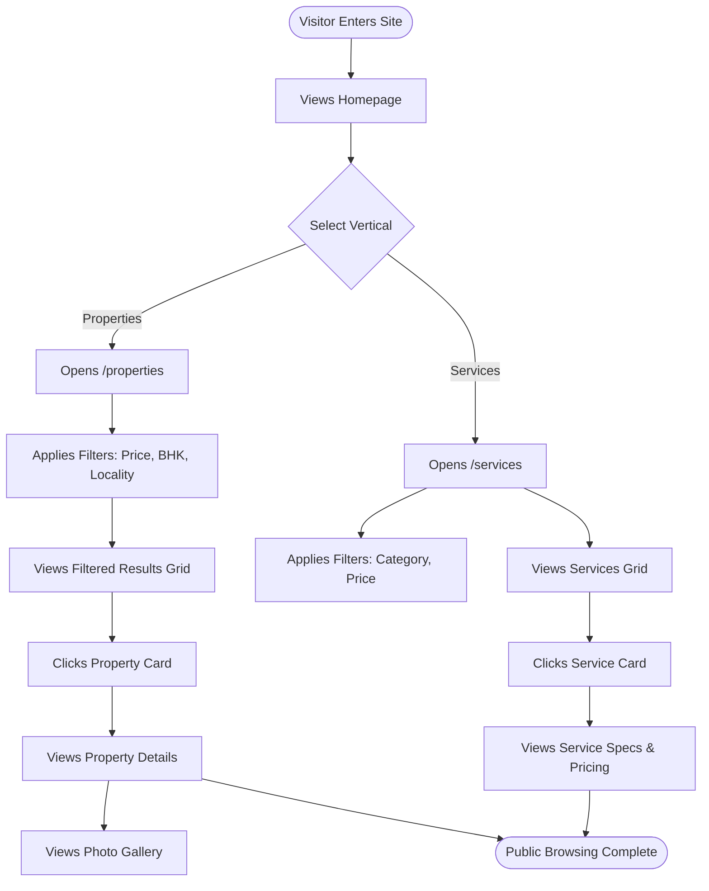

### Flow 2: Signing In With Google
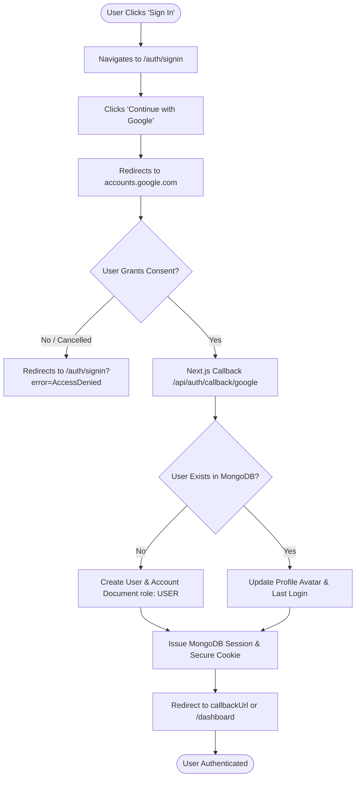

### Flow 3: Creating and Publishing a Property Listing
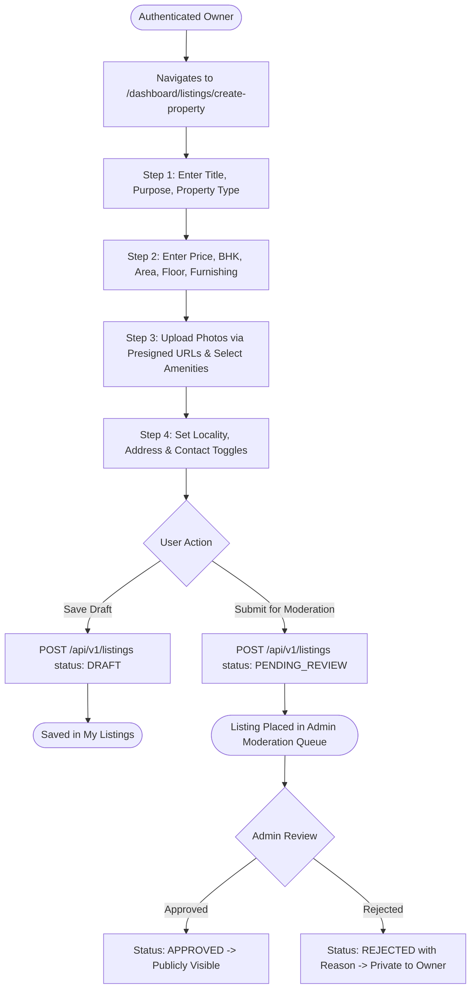

### Flow 4: Creating and Publishing a Service Listing
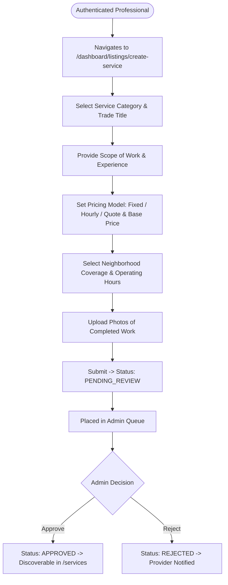

### Flow 5: Contacting an Owner or Provider Directly
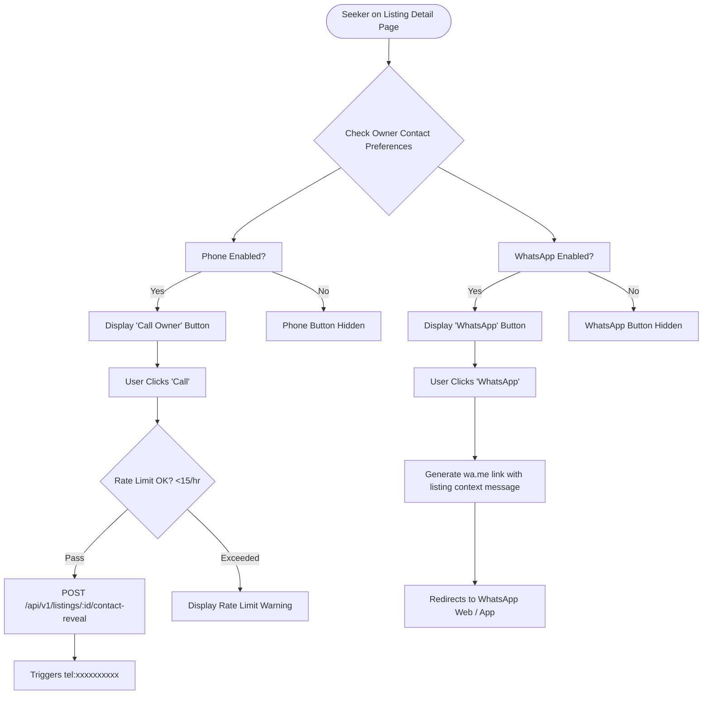

### Flow 6: Requesting a Service Booking
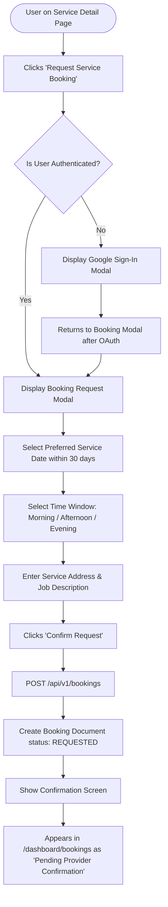

### Flow 7: Responding to a Booking Request (Provider Flow)
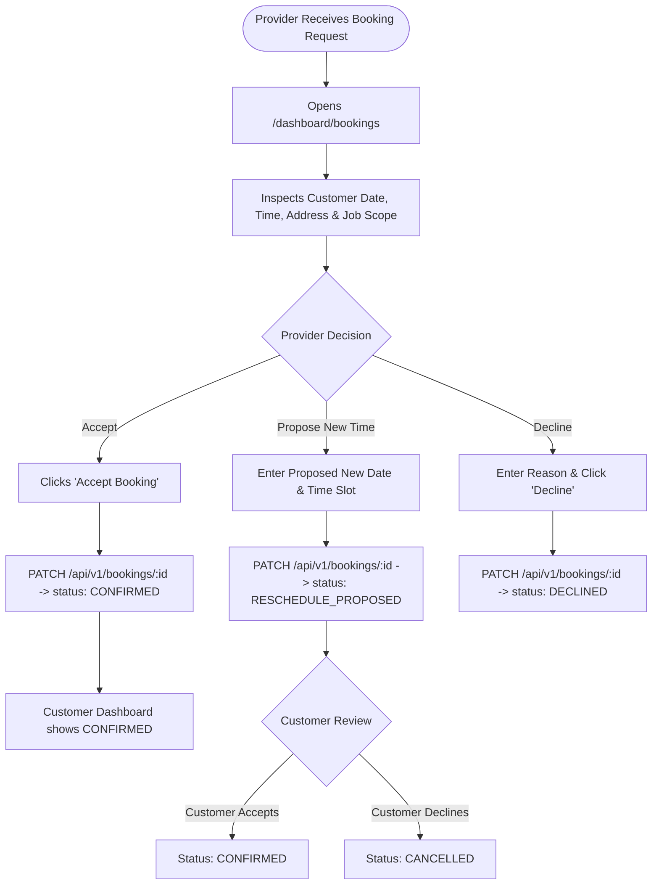

### Flow 8: Saving and Managing Listings
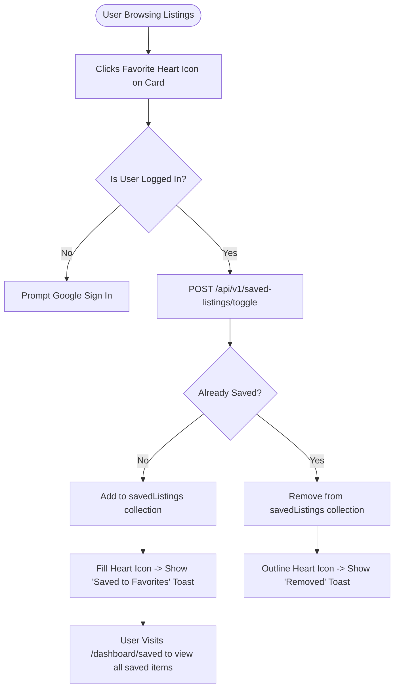

### Flow 9: Admin Review and Listing Approval
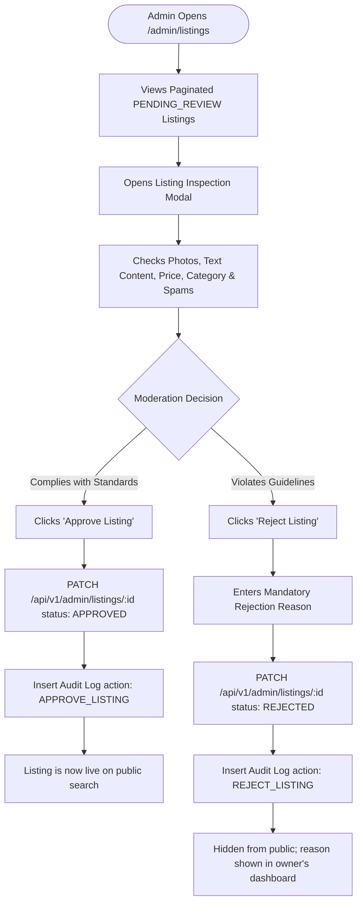

### Flow 10: Reporting an Inappropriate Listing
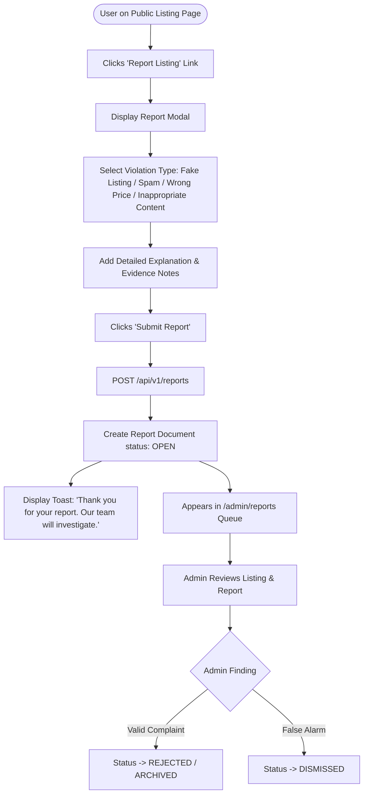
