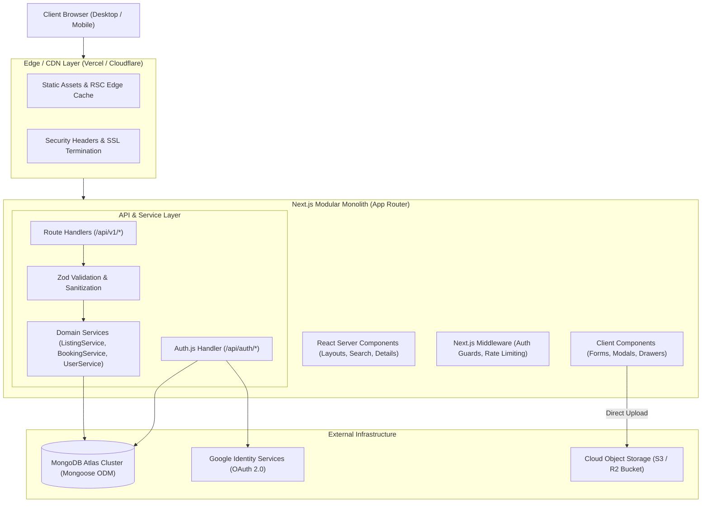
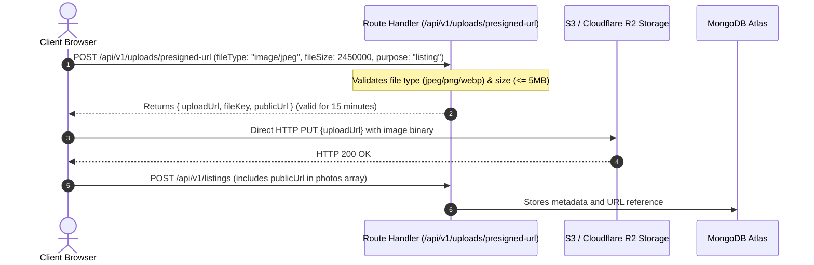

# Technical Architecture & System Design

## Document Information
- **Document Title**: Technical Architecture, System Topology & Engineering Specifications
- **Phase**: W0 — Architecture & Product Specification
- **Version**: 1.0.0
- **Status**: Approved Baseline

---

## 1. Architectural Philosophy: The Modular Monolith

The marketplace is architected as a **Modular Monolith** using Next.js App Router. Rather than dispersing early engineering capacity across distributed microservices (which introduces network latency, serialization overhead, distributed transactions, and operational complexity), all features exist within a single repository and runtime.

### Guiding Architectural Tenets
1. **Colocated Domain Modules**: Code is partitioned by business domains (`properties`, `services`, `bookings`, `auth`, `admin`) rather than purely technical splits.
2. **Unified Data & Boundary Isolation**: All domains share a single MongoDB Atlas database cluster, but interact strictly through isolated domain service modules (`src/services/*`) to prevent spaghetti dependencies.
3. **Hybrid Compute Architecture**: Leverage Next.js Server Components (RSC) for zero-client-JS data rendering, instant SEO, and reduced client bundles, while isolating dynamic interactivity (filters, modals, forms) to Client Components (`"use client"`).
4. **Zero-Binary Database Rule**: MongoDB stores only textual metadata, geospatial coordinates, and storage URIs. All binary media (images, documents) are handled via cloud object storage presigned URLs directly between the browser and storage bucket.



---

## 2. Technology Stack & Component Responsibilities

| Tier / Component | Technology | Version / Spec | Responsibility |
| :--- | :--- | :--- | :--- |
| **Framework** | Next.js App Router | 16.x / React 19 | Full-stack server and client application rendering, routing, and API handling. |
| **Language** | TypeScript | 5.x (Strict mode) | Type-safe development across database models, APIs, and UI components. |
| **Styling** | Tailwind CSS | Latest (Vanilla Tokens) | Utility-first styling utilizing approved corporate color palette tokens. |
| **Database** | MongoDB Atlas | 7.0+ (M0/M10 Tier) | Document database with 2dsphere geospatial indexing and flexible schema. |
| **ODM / Driver** | Mongoose | 8.x | Schema validation, type casting, population, and lifecycle hooks. |
| **Authentication** | Auth.js (NextAuth.js) | 5.x beta / core | Google OAuth provider integration, secure cookie management, MongoDB session adapter. |
| **Validation** | Zod | 3.x | Schema-based runtime validation for API requests, forms, and environment variables. |
| **Object Storage** | AWS S3 / Cloudflare R2 | S3-Compatible API | Secure, durable storage for listing images via presigned URLs. |
| **Icons** | Lucide React | Standard | Clean, accessible SVG iconography. |

---

## 3. Approved Design System & Tailwind Configuration

The project preserves the approved color palette without introducing extraneous gradients, glassmorphism, or non-approved accent colors.

### 3.1 Design Palette & Token Mapping

| Token Name | Hex Code | Semantic Role | Tailwind Utility Class |
| :--- | :--- | :--- | :--- |
| **Forest Green** | `#214A3B` | Primary brand color, headers, primary CTA buttons, active state highlights. | `bg-forest-green`, `text-forest-green`, `border-forest-green` |
| **Light Green** | `#E4EDE6` | Secondary accent, primary badge backgrounds, subtle callout cards, active tab pills. | `bg-light-green`, `text-forest-green` |
| **Light Purple** | `#EAE7F5` | Complementary category accent (specifically used for Services to visually distinguish from Properties). | `bg-light-purple`, `text-purple-900` |
| **Off-White** | `#F5F7F4` | App background canvas, card surfaces, table striping, neutral input backgrounds. | `bg-off-white`, `border-off-white` |
| **Dark Text** | `#202923` | High-contrast body typography, page headings, high-importance labels. | `text-dark-text` |
| **Muted Text** | `#68736C` | Secondary captions, metadata timestamps, input placeholders, breadcrumbs. | `text-muted-text` |

### 3.2 Visual Differentiation: Properties vs Services
- **Property Visual Signature**:
  - Accent Badge: Light Green (`#E4EDE6`) background with Forest Green (`#214A3B`) text.
  - Card Structure: Prominent photo carousel, BHK/Area badges, price per month / total price.
- **Service Visual Signature**:
  - Accent Badge: Light Purple (`#EAE7F5`) background with deep purple/slate text.
  - Card Structure: Provider circular avatar, verified badge, hourly/fixed rate indicator, coverage localities tag list.

---

## 4. Frontend & Backend Responsibilities

### 4.1 Server Components (RSC) vs Client Components
```
                    ┌───────────────────────────────────────────────┐
                    │               Page / Layout (RSC)             │
                    │ - Data Fetching via Service Layer             │
                    │ - Dynamic SEO Meta Tags Generation            │
                    │ - Initial HTML Streamed to Browser            │
                    └───────────────────────┬───────────────────────┘
                                            │
                    ┌───────────────────────┴───────────────────────┐
                    ▼                                               ▼
     ┌───────────────────────────────┐               ┌───────────────────────────────┐
     │    Server Component (RSC)     │               │   Client Component ("use client")
     │ - Static Card Grid Markup     │               │ - Interactive Filter Drawers  │
     │ - Breadcrumbs & Descriptions  │               │ - Image Carousel Swiper       │
     │ - Footer & Legal Links        │               │ - Booking Modal Dialog        │
     │ - Server-rendered Markdown    │               │ - Contact Reveal Action Button│
     └───────────────────────────────┘               └───────────────────────────────┘
```

- **Server Components (Default)**:
  - Used for `/properties`, `/properties/[id]`, `/services`, `/services/[id]`, `/`, and admin layout shells.
  - Directly invoke domain service functions (e.g., `ListingService.getPublicListings(...)`) during server render without making loopback HTTP calls to internal Route Handlers.
  - Zero JavaScript added to the client bundle for rendering static copy, specifications, and layout wrappers.
- **Client Components (`"use client"`)**:
  - Explicitly isolated to interactive leaf nodes:
    - Search input boxes with debounced state.
    - Faceted filter sidebar and mobile drawers.
    - Photo lightbox modal and touch carousels.
    - Multi-step listing creation forms with client-side Zod validation.
    - Service booking request modal dialogs.
    - Click-to-reveal phone dialer and WhatsApp action buttons.

### 4.2 Route Handlers vs Server-Side Service Functions
To prevent code duplication and unnecessary network hops:
- **Service Functions (`src/services/*`)**:
  - House the core domain business logic, Mongoose queries, permission checks, and database transactions.
  - Examples: `ListingService.createListing()`, `BookingService.transitionStatus()`, `UserService.getUserProfile()`.
  - Can be imported directly by Server Components for fast server-side data fetching.
- **Route Handlers (`src/app/api/v1/*`)**:
  - Thin HTTP controller adapters around the Service functions.
  - Responsibilities: Parse incoming JSON / query parameters, validate payload using Zod schemas, extract session from cookies, call the appropriate Service function, and return formatted JSON with appropriate HTTP status codes.
  - Used by Client Components when performing asynchronous mutations (e.g., submitting a booking request, uploading a listing, toggling a favorite).

---

## 5. Database Access Pattern: Mongoose Singleton in Next.js

In a serverless or hot-reloading Next.js runtime, repeated file executions can instantiate multiple Mongoose connection pools, resulting in database connection exhaustion. We implement a cached global connection singleton pattern.

### Mongoose Connection Strategy (`src/lib/db.ts`)
```typescript
import mongoose from 'mongoose';

const MONGODB_URI = process.env.MONGODB_URI;

if (!MONGODB_URI) {
  throw new Error('Please define the MONGODB_URI environment variable inside .env.local');
}

interface MongooseCache {
  conn: typeof mongoose | null;
  promise: Promise<typeof mongoose> | null;
}

declare global {
  var mongooseCache: MongooseCache | undefined;
}

let cached: MongooseCache = global.mongooseCache || { conn: null, promise: null };

if (!global.mongooseCache) {
  global.mongooseCache = cached;
}

export async function connectToDatabase(): Promise<typeof mongoose> {
  if (cached.conn) {
    return cached.conn;
  }

  if (!cached.promise) {
    const opts: mongoose.ConnectOptions = {
      bufferCommands: false,
      maxPoolSize: 10, // Maintain optimal pool size per serverless container
      serverSelectionTimeoutMS: 5000,
      socketTimeoutMS: 45000,
    };

    cached.promise = mongoose.connect(MONGODB_URI!, opts).then((mongooseInstance) => {
      return mongooseInstance;
    });
  }

  try {
    cached.conn = await cached.promise;
  } catch (e) {
    cached.promise = null;
    throw e;
  }

  return cached.conn;
}
```

---

## 6. Cloud Object Storage for Media Assets

To comply with the strict **Zero-Binary Database Rule**, image files are never streamed through Next.js server memory or stored in MongoDB.

### Media Upload Architecture


---

## 7. Standardized API Response & Error Handling

All Route Handlers under `/api/v1/` return a uniform JSON response contract, ensuring predictable handling across client hooks.

### 7.1 Success Envelope
```json
{
  "success": true,
  "data": { ... },
  "meta": {
    "page": 1,
    "limit": 20,
    "totalCount": 142,
    "totalPages": 8
  }
}
```

### 7.2 Error Envelope
```json
{
  "success": false,
  "error": {
    "code": "VALIDATION_FAILED",
    "message": "The provided listing payload failed schema validation.",
    "details": [
      {
        "field": "price",
        "issue": "Price must be a positive integer greater than 0"
      }
    ]
  }
}
```

### 7.3 Canonical Error Code Matrix
- `UNAUTHENTICATED` (401): Valid session is required to perform this action.
- `FORBIDDEN` (403): User lacks ownership rights or required administrative role.
- `NOT_FOUND` (404): Requested entity does not exist or has been removed.
- `VALIDATION_FAILED` (422): Input payload failed Zod schema parsing.
- `RATE_LIMIT_EXCEEDED` (429): Action throttled to prevent scraping or spam.
- `INTERNAL_SERVER_ERROR` (500): Unhandled exception logged with correlation ID.

---

## 8. Logging, Monitoring & Observability

### 8.1 Structured JSON Logging
All application logs are formatted as structured JSON to facilitate ingestion by observability platforms (e.g., Datadog, Axiom, CloudWatch).
```json
{
  "timestamp": "2026-10-17T09:30:00.123Z",
  "level": "INFO",
  "service": "marketplace-web",
  "traceId": "req_8f1a23b9d0",
  "userId": "653b1f9c0e2a1b001a9f9999",
  "action": "LISTING_SUBMITTED",
  "metadata": {
    "listingId": "653b204e0e2a1b001a9f8888",
    "type": "PROPERTY",
    "status": "PENDING_REVIEW"
  }
}
```

### 8.2 Audit Trail (`auditLogs` Collection)
Critical administrative actions are recorded in an append-only MongoDB collection. Every audit record includes:
- `adminUserId`: The administrator executing the change.
- `action`: E.g., `LISTING_APPROVED`, `LISTING_REJECTED`, `USER_SUSPENDED`.
- `targetEntity`: E.g., `Listing`, `User`.
- `targetId`: BSON ObjectId of the target entity.
- `previousState` & `newState`: Snapshot of modified attributes.
- `reasonNotes`: Free-text justification entered by the moderator.
- `ipAddress`: Request source IP for forensic tracking.

---

## 9. Environment Configuration Specification

The following environment variables represent the complete configuration contract required to run the application:

```ini
# ==============================================================================
# ENVIRONMENT & GENERAL
# ==============================================================================
NODE_ENV=development
NEXT_PUBLIC_APP_URL=http://localhost:3000

# ==============================================================================
# LAUNCH GEOGRAPHY CONFIGURATION
# ==============================================================================
NEXT_PUBLIC_LAUNCH_CITY_NAME="Metropolis"
NEXT_PUBLIC_LAUNCH_CITY_CODE="METRO"
NEXT_PUBLIC_LAUNCH_STATE="State"

# ==============================================================================
# DATABASE CONFIGURATION
# ==============================================================================
MONGODB_URI=mongodb+srv://<username>:<password>@cluster0.xxxxx.mongodb.net/marketplace?retryWrites=true&w=majority
MONGODB_DB_NAME=marketplace

# ==============================================================================
# AUTHENTICATION (Auth.js v5 / Google OAuth)
# ==============================================================================
AUTH_SECRET=generate_with_openssl_rand_base64_32
AUTH_URL=http://localhost:3000/api/auth
AUTH_GOOGLE_ID=your_google_oauth_client_id.apps.googleusercontent.com
AUTH_GOOGLE_SECRET=your_google_oauth_client_secret

# ==============================================================================
# CLOUD OBJECT STORAGE (S3 / Cloudflare R2)
# ==============================================================================
STORAGE_ENDPOINT=https://<account_id>.r2.cloudflarestorage.com
STORAGE_REGION=auto
STORAGE_BUCKET_NAME=marketplace-listings-media
STORAGE_ACCESS_KEY_ID=your_r2_or_s3_access_key
STORAGE_SECRET_ACCESS_KEY=your_r2_or_s3_secret_key
NEXT_PUBLIC_STORAGE_PUBLIC_URL=https://media.marketplace.com

# ==============================================================================
# SECURITY & RATE LIMITING
# ==============================================================================
CONTACT_REVEAL_HOURLY_LIMIT=15
LISTING_SUBMIT_DAILY_LIMIT=10
```

---

## 10. Repository Organization & Folder Structure

```
webapp/
├── docs/                               # W0 Architecture & Specification Documentation
│   ├── README.md                       # Master index of documents
│   ├── product-requirements.md         # Deliverable A: PRD
│   ├── sitemap-and-user-flows.md       # Deliverable B: Information Architecture & Flows
│   ├── technical-architecture.md       # Deliverable C: Engineering Specifications
│   ├── database-schema.md              # Deliverable D: Mongoose Data Models
│   ├── api-contracts.md                # Deliverable E: REST API Contracts
│   ├── authentication-and-authorization.md # Deliverable F: Auth.js & Security
│   ├── security-and-privacy.md         # Deliverable G: Security Protocols
│   └── development-roadmap.md          # Deliverable H: Roadmap W0-W9
├── public/                             # Static public assets (favicons, logos)
├── src/
│   ├── app/                            # Next.js App Router root
│   │   ├── (auth)/                     # Auth route group
│   │   │   └── auth/signin/page.tsx
│   │   ├── (public)/                   # Public browsing routes
│   │   │   ├── page.tsx                # Homepage
│   │   │   ├── properties/             # Property search & details
│   │   │   │   ├── page.tsx
│   │   │   │   └── [id]/page.tsx
│   │   │   ├── services/               # Service search & details
│   │   │   │   ├── page.tsx
│   │   │   │   └── [id]/page.tsx
│   │   │   └── providers/[id]/page.tsx # Public provider profile
│   │   ├── dashboard/                  # Authenticated user hub
│   │   │   ├── page.tsx
│   │   │   ├── listings/               # My Listings & Creator Forms
│   │   │   │   ├── page.tsx
│   │   │   │   ├── create-property/page.tsx
│   │   │   │   ├── create-service/page.tsx
│   │   │   │   └── edit/[id]/page.tsx
│   │   │   ├── bookings/page.tsx       # Booking management
│   │   │   └── saved/page.tsx          # Saved listings
│   │   ├── admin/                      # Moderation & management
│   │   │   ├── page.tsx
│   │   │   ├── listings/page.tsx
│   │   │   ├── users/page.tsx
│   │   │   ├── reports/page.tsx
│   │   │   └── audit-logs/page.tsx
│   │   ├── api/                        # Route Handlers
│   │   │   ├── auth/[...nextauth]/route.ts
│   │   │   └── v1/
│   │   │       ├── listings/route.ts
│   │   │       ├── bookings/route.ts
│   │   │       ├── saved-listings/route.ts
│   │   │       ├── reviews/route.ts
│   │   │       ├── reports/route.ts
│   │   │       ├── uploads/presigned-url/route.ts
│   │   │       └── admin/
│   │   ├── layout.tsx                  # Root layout
│   │   ├── error.tsx                   # Global error boundary
│   │   └── not-found.tsx               # 404 handler
│   ├── components/                     # Modular UI Components
│   │   ├── ui/                         # Atomic base components (buttons, badges, inputs)
│   │   ├── layout/                     # Header, footer, navigation bar
│   │   ├── listings/                   # Cards, carousels, spec tables
│   │   ├── filters/                    # Filter panels, search bars
│   │   ├── bookings/                   # Booking forms, timeline chips
│   │   └── admin/                      # Moderation drawers, review buttons
│   ├── lib/                            # Core infrastructure singletons
│   │   ├── db.ts                       # Mongoose connection singleton
│   │   ├── auth.ts                     # Auth.js configuration & options
│   │   ├── s3.ts                       # Cloud storage client
│   │   └── utils.ts                    # Formatting & styling helper functions
│   ├── models/                         # Mongoose Schema Definitions
│   │   ├── User.ts
│   │   ├── Account.ts
│   │   ├── Session.ts
│   │   ├── Listing.ts
│   │   ├── Booking.ts
│   │   ├── SavedListing.ts
│   │   ├── Review.ts
│   │   ├── Report.ts
│   │   └── AuditLog.ts
│   ├── services/                       # Server-side domain business logic
│   │   ├── listing.service.ts
│   │   ├── booking.service.ts
│   │   ├── user.service.ts
│   │   ├── admin.service.ts
│   │   └── storage.service.ts
│   └── types/                          # Shared TypeScript interfaces & Zod schemas
│       ├── listing.types.ts
│       ├── booking.types.ts
│       └── api.types.ts
├── tailwind.config.ts                  # Tailwind configuration with approved tokens
├── tsconfig.json                       # TypeScript compiler options
└── package.json                        # Dependencies and scripts
```
